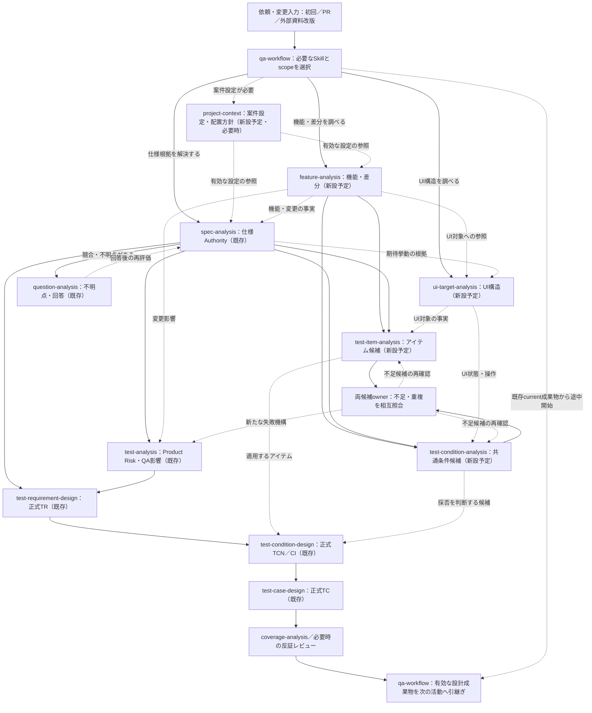
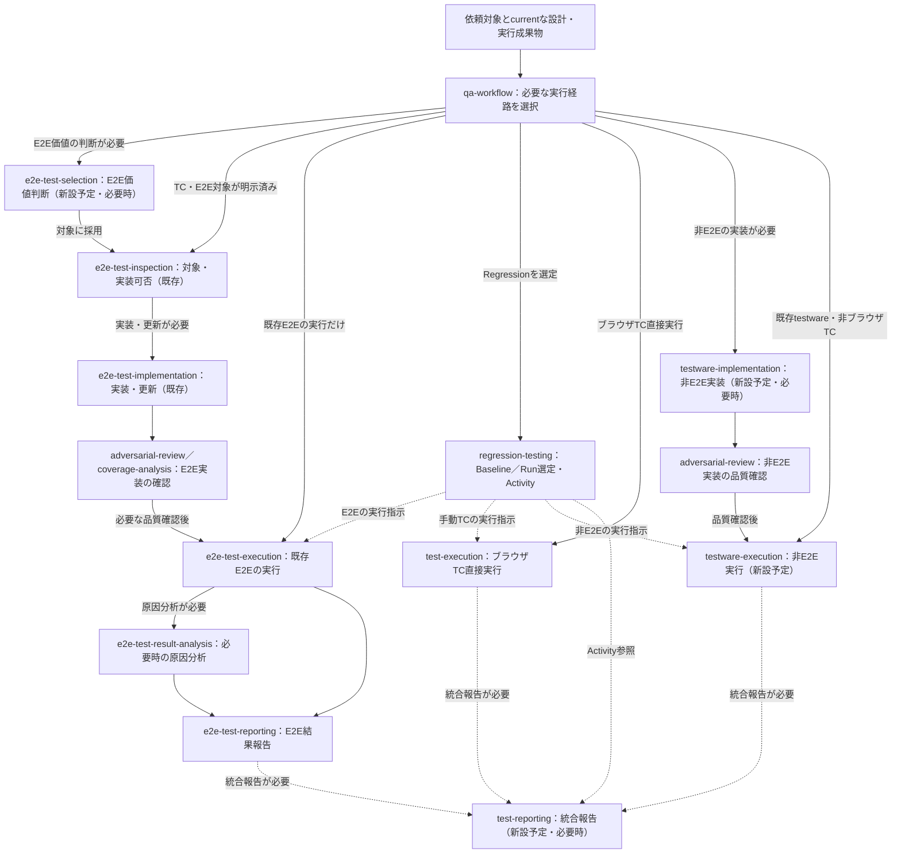

# 開発変更とQA成果物の継続的な追跡・抽出網羅率強化 Plan

## 対象ブランチと目的

- 実装ブランチ：`feat/development-qa-traceability`
- 調査基準：`main` commit `329cd8ad75ecde9d21c2e60f791214ca27fa2602`（2026-11-07確認）
- この文書は実装Plan。Plan作成時点でコード、Skill、CI、テストは変更しない。
- 実装着手時には作業ブランチのHEADと`main`、関連する未マージPRの変更を確認し、競合・前提変更を解消する。目的・範囲・完了条件を独自に縮小しない。

**目的**：開発で実装・変更される製品全体の機能と振る舞いを継続的に抽出・構造化し、現在有効な仕様とQA成果物の対応を維持する。初回の全体分析、PR更新、マージ後、リリース前の各時点で、機能抽出漏れ、仕様未反映、テスト不足、陳腐化した成果物を検出し、必要なQA活動へ接続する。

「開発側の確認済み情報源から見つかった全候補を追跡できること」と「製品全体の全機能を確実に発見できたこと」は区別する。情報源が未確認・不完全な場合は抽出網羅率を製品全体の保証として提示しない。

## 本PlanとQA全工程Planの境界

本Planは**開発連動QA**（開発差分から製品機能・仕様・アイテム・共通条件候補・正式設計への追跡、保存、製品CI連携）を担当する。QA案件全体の要求分析・アーキテクチャ・計画／進捗・欠陥追跡・統合報告・QA活動評価および非Webテストコードの実装・実行は[QA全工程の追加責務Plan](./2026-11-07_170134_qa-full-process-implementation.md)とその詳細文書が担当する。全体の依存関係、正本、実装順序、未実装時の受入条件は[Planインデックス](./2026-11-07_170134_qa-full-process-implementation_00_index.md)を参照する。工程間handoff、外部資料改版、E2Eへの接続と受入の詳細は[継続workflow・受入契約](./2026-11-07_170134_qa-full-process-implementation_03_workflow-and-acceptance.md)を正本とする。新設Skillの成果物を検証してworkflow完了に反映する規則は[workflow runtime・Regression契約](./2026-11-07_170134_qa-full-process-implementation_04_workflow-runtime-and-regression.md)、実装・実行方式は[テスト実行・品質契約](./2026-11-07_170134_qa-full-process-implementation_05_testware-execution-and-quality.md)に従う。本Planの既存の15完了条件は変更しない。

## 合意済みの要求

1. 抽出対象はUI、API、バッチ、外部連携、権限、データ処理を含む製品機能全体。単なる画面一覧へ縮小しない。
2. 開発情報源はIssue、仕様書、設計資料、コード、PR差分、既存テスト、必要な実対象観測。利用可能な各情報源の確認範囲・revision・未確認範囲を記録する。
3. 初回全体分析に加え、PR更新・マージ後・リリース前に継続確認する。前回成果物を再利用し、変更影響のある範囲を再確認する。
4. 未分類の開発差分はCI失敗。分類済みの仕様・テスト不足は根拠とプロダクトリスクに応じて判定する。失敗・警告・ブロック中を混同しない。
5. Skillの肥大化を避け、独立した責務は分割する。ただし機能構造、仕様、テスト設計、workflow状態に重複する正本を作らない。

## QAワークフロー再設計の追加合意（2026-11-07〜11-08）

本節のQ01〜Q25は今回の再設計質問であり、既存Planで引用するQ01（受入製品）、Q04（機能母集団）、Q20（共通時間・費用上限）とは別の質問番号とする。従来の合意は維持する。

1. **テストアイテム（Q01〜Q04）**：機能・画面・API・バッチ・コンポーネント等のテスト対象。複数粒度の親子関係を持ち、製品機能IDとは別の安定IDで多対多に対応する。計画・未実装・実装済み・廃止を区別する。
2. **仕様とUI（Q05・Q07〜Q09）**：有効な仕様根拠・期待挙動・業務状態・イベント・認証/認可・データ整合・外部連携の期待仕様は`spec-analysis`を正本とする。UI構造・操作・表示状態・画面遷移は独立UI Skillが管理する。UIとAPIの認可を分け、ロール、所有者・テナント、データ状態、拒否時応答・副作用・監査記録を根拠付きで追う。製品機能一覧の正本は`feature-analysis`。
3. **Product Risk（Q10〜Q11）**：仕様とテストアイテム・テスト条件候補を並行して識別・照合した後、TRより前に一次評価する。機能・アイテム・横断要件を参照でき、条件・変更の新証拠が出れば影響するRiskだけ再評価する。候補の未確定を理由に新しい期待仕様やリスクを捏造しない。
4. **TRと技法（Q12〜Q15）**：有効な仕様根拠とRiskからTRを作り、アイテムとテストレベルを明示する。`test-condition-analysis`が条件候補を`test-item-analysis`と並行して識別し、正式TCNは後続の`test-condition-design`がTRへ結び付ける。同一アイテムIDを複数テストレベルで共有する。`test-analysis`が技法候補と目的を示し、`test-condition-design`が採否とcoverage基準・CIを確定する。
5. **条件の再利用（Q16〜Q18・Q22）**：再利用する共通条件の識別・安定ID・履歴を`test-condition-analysis`が独立管理し、各アイテムへ適用した正式TCNには`test-condition-design`が別IDを付ける。候補母集団と適用可否を確認し、採用しない場合は対象外・適用不能・別レベル・重複・未確認・ブロック中と根拠・再確認条件を記録する。全直積を機械的に採用しない。具体値・状態遷移・多次元組み合わせは既存CIと技法で扱う。
6. **期待結果（Q19〜Q21）**：アイテム×条件の対応付け時に期待結果候補を作り、個々の候補の有効な仕様根拠・観測方法・状態変化を記録する。1組に複数候補を許す。具体的な実行可能期待結果は`test-case-design`で確定する。
7. **mode分割（Q23）**：独立した成果物・判断責務を持つmodeは独立Skillへ分離する。`continuous / gated`や`input_mode=direct / artifact`などの実行・入出力設定は分割しない。
8. **規範（Q25）**：IVECとISTQBを規範的参考とし、記述が異なる場合は差を明示して実務上の統合設計を行う。認定制度の工程名をSkill名と一対一に対応させない。
9. **成果物の構成（Q06）**：AIに加え人間もQA成果物を直接編集・レビューする。初回の成果物書込み前に、既存配置・各成果物の正本・ファイル単位の編集可能範囲・機能別の参照方法を調査し、利用者と配置・編集方針を合意する。機能ID／アイテムID／条件ID／TC IDと依存revisionを変更影響の正本とし、ファイルパスをIDにしない。物理分割は人間の編集・レビューの負担、変更の独立性、既存schema・writerの制約で決め、機能別ファイルへの一律移動や第二の正本を作らない。

**回答を補完せずに残す事項**：

- Q20：具体的な選択肢は未回答。ただし「有効な仕様根拠は必須。状態・データ・具体値等は結果の一意性に影響するときだけ必須」との補足は適用する。個別候補の根拠・必要条件が欠ける場合だけ未確定/blockedとし、一律の入力要件を推測しない。
- Q24：代表シナリオは任意・未回答。独立fixtureで権限×状態・API・バッチの受入を検証するが、案件の正式仕様や受入製品の決定とはしない。

### 参照規範の確認範囲

- [IVEC公式シラバス配布ページ](https://www.ivia.or.jp/item43/item38)：デザイナー/アーキテクトV3.2（2025-09-01更新）の公開を確認。今回はPDF本文全章を検証できていないため、特定の詳細作業をIVECが必須化しているとは断定しない。実装前に原本との節単位の照合を実施する。
- [ISTQB CTFL v4.0.1 1.4.1](https://www.istqb.org/wp-content/uploads/2024/11/ISTQB_CTFL_Syllabus_v4.0.1.pdf)：テスト分析でテスト対象・test basisからテスト条件を識別し、テスト設計でcoverage itemとケースを具体化する。本repositoryの`test-analysis`はProduct Risk中心であり、ISTQBの活動名と完全一致しない。
- [ISO/IEC/IEEE 29119-1:2022](https://www.iso.org/obp/ui/)：test itemはテスト対象となる作業成果物。test coverage itemは測定対象の属性。同版はテスト条件の定義を持つが、テスト設計にはtest modelを使うと明記している。TCNとtest modelを無条件に同一視しない。

## 現状と既存契約

### 確認した実装

| 現行owner / ファイル                                                                         | 再利用する契約                                                           | 残る不足                                                                            |
| -------------------------------------------------------------------------------------------- | ------------------------------------------------------------------------ | ----------------------------------------------------------------------------------- |
| `skills/spec-analysis/SKILL.md`、`references/ui-test-target-analysis.md`                     | 有効な仕様根拠、SPEC / DECISION / INFERENCE / UNKNOWN、UI target package | UI以外を含む製品全体の機能母集団・抽出網羅率の正本がない                            |
| `skills/spec-analysis/assets/ui-test-target-analysis/00_scope_and_context.md`                | `SCOPE`の対象範囲とready / blocked、`UIOP → US → UC → Behavior → AC`     | SCOPEには親Scope列がなく、製品機能全体の階層とは一致しない                          |
| `skills/spec-analysis/assets/ui-test-target-analysis/01_ui_structure_and_navigation.md`      | 画面・状態等のUI構造の親子参照                                           | 機能階層の代替にはできない                                                          |
| `skills/spec-analysis/assets/ui-test-target-analysis/08_repository_implementation_status.md` | 確認済みRepositoryのrevision・実装事実                                   | 開発情報源全件の発見・差分母集団の完了判定ではない                                  |
| `skills/spec-analysis/scripts/ui_target_package.py`                                          | UI packageのID、参照検証、UNKNOWN、snapshot、Machine Entity、原子的更新  | 追加責務を同ファイルへ集中させない（調査時約218 KB）                                |
| `skills/test-analysis/scripts/change_impact.py`                                              | 既知変更からの最短影響経路                                               | ノード型はAuthority / Risk / TR / TCN / CI / TCで、開発差分・製品機能を直接扱わない |
| `skills/coverage-analysis/scripts/traceability.py`                                           | 仕様・Risk・TR・TCN・CI・TCの追跡性と閉鎖性                              | 抽出前の開発機能候補、情報源確認の完全性は対象外                                    |
| `skills/qa-workflow/SKILL.md`、`scripts/artifact_graph.py`、`scripts/workflow_runtime.py`    | routing、局所blocked、freshness、状態・revision・CAS、previous baseline  | 開発差分を起点とした機能抽出・再分析の入口を追加する                                |
| `skills/test-target-inspection/SKILL.md`                                                     | 実対象の観測事実、条件、鮮度、安全・cleanup                              | 観測事実を仕様Authorityに自動昇格しない                                             |
| `skills/regression-testing/`、既存E2E Skill                                                  | baseline、対象選定、実装・実行結果                                       | 機能差分から関連TC / E2E / Regressionの再評価に接続する                             |

現行UI target packageは`ui-target-v1`、既存Machine Entityは`entity-state-v2`。Scope ownership、部分再実行、stale / deleted / legacy、Machine Runtime証拠、前回成果物からの復元と移行経路は既存契約を尊重する。`qa-workflow`と`qa-knowledge`の保存先・並行更新・現在性の契約を別実装で置換しない。UI target packageは案件側の成果物であり、このSkillリポジトリに製品固有データを書き込まない。

既存テストの参照先：`tests/skills/runtime/test_ui_target_package.py`、`test_test_analysis_change_impact.py`、`test_coverage_analysis_traceability.py`、`test_traceability_runtime.py`、`test_qa_workflow_runtime.py`、`test_migration_preflight.py`、`tests/skills/evals/{deterministic,semantic}/`。

CIの正本：`.github/workflows/validate-skills.yml`、`deterministic-output-evals.yml`、`semantic-output-evals.yml`、`code-quality.yml`。これらは主として本Skill repositoryを検証し、利用先製品の開発イベントを自動収集する仕組みではない。

参照：`PLANS.md`、`.agents/skills/feature-plan/SKILL.md`、`docs/plans/2026-10-01_201500_ui-test-target-analysis-mode.md`、`docs/plans/2026-09-22_123900_qa-artifact-graph-harness.md`。

## 責務分担と変更範囲

### 新規のProject Context作成・管理Skill

`skills/project-context/`を追加し、案件設定文書の**既存確認・新規作成・検証・差分更新・履歴管理・参照提供**を一貫して担当する。これは案件情報の正本を管理するSkillであり、`qa-workflow`のroutingとは別責務とする。案件により情報源や保存先が変わっても、Skillの責任範囲を変えない。

- **入力**：対象案件を識別できる情報、ユーザーが明示した既存Project Context参照または許可済みの探索範囲、取得可能な案件資料・既存QA成果物の根拠、今回実行するSkillが必要とする設定項目。案件固有の場所を推測して全ファイルシステムや無関係なRepositoryを探索しない。
- **既存確認**：明示された文書や、案件の許可済みroot内で宣言された候補pathを調べ、`存在` / `不存在を確認` / `参照未指定` / `アクセス不能` / `重複・曖昧`を区別する。見つからないこととアクセスできないことを混同しない。複数の正本候補を自動統合しない。
- **新規作成**：既存文書がないと確定した場合に限り、`skills/qa-workflow/assets/project-context-template.md`を既定形として候補を組み立てる。確認できた案件情報のみ記入し、未確認値は空欄・`UNKNOWN` / `N/A`・`（未設定）`で明示する。文書の保存場所・対象案件・書込み権限を確定する前に保存しない。
- **更新**：既存の情報源優先順位、正式用語、決定事項・仮定、成果物参照、環境条件、識別子と履歴を保持する。変更対象項目、変更理由、根拠sourceとrevision、元文書revision、変更後revisionを記録し、無関係な欄を再生成・初期化しない。
- **検証と提供**：案件設定の構造検証・必要項目検証を既存の`qa-workflow/scripts/artifact_graph.py`にある`parse_project_context` / `validate_required_context_fields`で行う。必要なfieldの値・content identity・文書ref / revisionと未解決項目を返し、担当Skillへ渡す。文書全体を確認済みとしただけで、必要な外部sourceの到達や権限を保証したことにはしない。
- **DEC / ASM**：Project ContextのSection 12 / 13がその案件の正本ownerである場合だけ、既存`qa-workflow/scripts/project_context_ids.py`の`materialize` / `validate-history`を使用する。他に正本ownerがあるDEC / ASMは参照のみとし、再採番・複製しない。
- **安全な保存**：案件の承認済み保存先に対し、新規はatomic create-if-absent、更新は保存先が提供するnative atomic conditional writeとexpected revisionを必須にする。保存後は独立再読込で文書内容・revision・参照を確認する。衝突、保存先未指定、条件付き更新非対応、履歴読込不能の場合は候補を返して保存をblockedとし、上書き・別pathへの自動退避・LLMによる成功推測をしない。
- **成果物**：現在のProject Contextへの一意の参照、revision、必要な項目と未設定一覧、検証結果、作成・更新履歴、競合時の再開先。文書自体の保存とworkflow実行状態の保存を混同しない。
- **Skill資源**：`SKILL.md`、`references/guidance.md`（発見・作成・更新・owner境界）、`references/data-contract.md`（入出力、保存・revision、エラー）、`assets/output-template.md`（確認結果）、`scripts/`（必要な保存・検証の決定論的helper）、`evals/`（trigger / deterministic / semantic）。既存parser・ID helperを複製せず、実際に使う入口と契約を維持する。

既存`qa-workflow`に残すものは、**workflow開始時のProject Context確認と`project-context`へのrouting、使用済み設定項目の`compare_used_context`による鮮度比較、設定変更の下流影響と再開先の決定**である。`qa-workflow`が文書の新規作成・更新を独自実装しない。既存parser / DEC・ASM helperとテンプレートは、現行の呼び出し元と外部参照を壊さないため既存pathの正本として再利用する。新Skillへのコード移動を目的にしたコピーや重複実装は行わない。

**初期化手順**：`qa-workflow`が新しい案件で初回分析を開始する際、Project Contextの既存確認と成果物の配置・編集方針の合意確認を`project-context`へ依頼する。存在すれば必要なfieldだけ検証して利用する。不存在なら、利用可能な証拠で作成候補を組み立て、保存先・権限・欠落した必須項目を確認して安全に作成する。Project Contextが未保存でも独立して実行できる読取専用の分析は続行してよい。ただしProject Contextに依存する継続保存、承認、CIの合否、再開に必要な設定が不足する範囲はblockedとする。すでに有効な文書がある案件では不要な再作成を行わない。

### 成果物の配置・人間編集方針の初期合意（Q06）

**担当**：新設予定の`project-context`が、初回案件設定の一部として成果物の保存先・配置・人間編集の方針を提案し、利用者の合意を確認して記録する。`qa-workflow`は初回／配置変更時にだけ`project-context`へ振り分ける。各ファイルのschema・構造検証・書込み・履歴の正本は引き続き担当Skillが所有する。**配置合意のための新Skillは追加しない**。

1. **既存構成の確認**：許可された案件rootと関連repo、正本の所在、既存のファイル命名・フォルダ、機能別の参照、手動編集の入口、generated／control file、既存writer・validator、ID・相互参照・revision・履歴を取得する。確認していない構成を新規案件の既定と推測しない。
2. **提案の対象**：成果物の正本owner、機能別に編集・レビューできる単位、横断条件・共通成果物の配置、元ファイルと生成一覧の区別、ファイル移動・改名時の参照維持、人間の編集後に必要な検証・保存手順を提示する。機能横断の条件や仕様根拠を機能別フォルダへ重複保存しない。
3. **初回合意**：新規案件または有効な配置方針のない案件では、既存構成の維持案と変更が必要な箇所を利用者へ提示し、**実成果物の新規保存・構成変更の前に**採用方針・保存先・編集権限を確認する。明示承認のないファイル移動、再配置、新しい保存形式への変換は行わない。読取専用の分析や、既に許可された既存操作は配置方針の未確定だけで止めない。
4. **合意の記録**：承認済み配置方針の説明・対象scope・承認根拠・変更条件をProject ContextのSection 12（DECの正本がここにある案件）へ、正本成果物・場所・revisionと機能別参照の入口をSection 14へ記録する。別の承認済み設定文書が正本なら、そのref／revisionを保持する。新しい`qa-context-field`、重複manifest、成果物の第二の正本を無条件に追加しない。
5. **人間による直接編集**：各担当Skillは、編集可能な**正本**と再生成される読取専用の一覧・control fileを区別する。人間が正本を直接編集した変更は、元のID・source revision・差分・権限を確認し、担当ownerのvalidator・条件付き保存・再読込を通して採用する。生成一覧やMANIFESTを直接編集して正本化しない。競合・不正参照・古いversionは既存の有効な成果物を維持して対象変更をblockedにする。
6. **機能別の確認**：機能IDから関連する仕様・UI・テストアイテム・条件・TR／TCN／CI／TC・実行結果・変更影響へ辿れる一覧または参照を用意する。この一覧は正本のIDとrevisionから導出し、別途更新すべき機能別の複製を作らない。人間が目的の正本ファイルと変更範囲を確認できることを受入とする。
7. **既存`ui-target-v1`の扱い**：現行の`00〜09`標準ファイル、`README.md`、`CHANGELOG.md`、`MANIFEST.md`、条件付きfileと`ui_target_package.py`のwriter・schema・ID・版・履歴・scope readinessを維持する。既存形式は原則として現行のまま利用し、機能別の確認はID参照・読取専用の導出一覧で補う。人間の編集・並行変更・PR差分の管理に実害があり、物理的な分割が必要と確認された場合に限り、各ownerの移行形式、互換読取、原子的切替、rollbackと回帰検証を用意してから変更する。
8. **繰返し確認の抑制**：有効な合意があり保存先・編集方法・owner境界が変わらない場合は再承認しない。配置変更の依頼、正本ownerの移管、既存path廃止、既存編集方式では安全に扱えない範囲が出たときのみ合意・必要な移行を更新する。

**受入**：新規案件の初回合意、既存案件の方針再利用、未承認の配置変更拒否、機能別参照から正本編集対象への到達、人間の直接編集を次回のAgent処理が正しく検出・検証、生成一覧の編集拒否、共通条件の正本重複防止、ファイル改名／移動によるID・履歴・下流参照・rollbackの維持を確認する。

### 新規の機能分析Skill

`skills/feature-analysis/`を追加し、製品機能の発見、機能階層、開発情報源との対応、候補の分類、抽出網羅率、機能単位の変更判定を担当する。これは仕様Authorityの判断やTC生成を担当しない。

- `SKILL.md`：利用契機、入力、責務境界、停止条件。
- `references/guidance.md`：情報源調査、機能同定、分解、抽出漏れ検査、変更・削除、分類の意味判断。
- `references/data-contract.md`：情報源snapshot、開発差分、機能一覧、階層、参照、分類、網羅率の機械可読契約。
- `assets/output-template.md`：人間が確認できる機能一覧、抽出・未確認・対応関係、判定結果。
- `scripts/`：既存Python 3.11 runtime契約に従い、構造・参照・revision・網羅率・差分・状態遷移を決定論的に検証する。意味判断はAgentと当該Skillが担当し、推測を構造検証で正当化しない。
- `evals/`：trigger、deterministic、semanticの正本データとvalidator。共通評価runtimeを再実装しない。

Skillの新設は、機能の母集団と階層がUI対象分析や仕様根拠とは異なる正本だからである。情報源ごと、画面/APIごと、指標ごとのSkillを増やさない。内部Pythonモジュールは入力正規化、候補照合、階層・参照検証、網羅率、履歴・永続化の責務で分割し、巨大な単一スクリプトを作らない。

### UIテスト対象分析・テストアイテム・E2E対象選定の独立Skill

- **`ui-target-analysis`（新設）**：UI構造・操作・画面表示状態・ナビゲーションと変更履歴を所有する。従来の`spec-analysis` UIテスト対象分析modeから分離する。仕様上の期待挙動、Authority / AC、UNKNOWNの解決は`spec-analysis`が所有し、UI Skillはcurrentな参照を保持する。現行`ui-target-v1`の00〜09、`ui_target_package.py`、scope readiness、Machine Entity、Manifestを調べ、互換読み出しと単一writerを守る。
- **`test-item-analysis`（新設）**：対象アイテムの安定ID、階層、機能IDへの多対多参照、予定・実装・廃止の状態、履歴と変更影響の正本。UI/非UIの現物・仕様参照を取り込み、機能・Authority・Risk・TCNの第二の正本を作らない。テストレベルごとに同一アイテムIDを別採番しない。`test-condition-analysis`と並行して候補を識別し、相互に不足候補を指摘する。
- **`e2e-test-selection`（新設）**：技術非依存のE2E候補・自動化目的・価値判断・採否と履歴を正本とする。旧`test-analysis`の`対象 / 実行範囲 = E2E対象選定`から移す。Playwright実装可否・locator・実行は`e2e-test-inspection`以降に残し、既存の直接開始経路を壊さない。
- **既存Skillに残す責務**：`spec-analysis`は期待仕様・業務状態・権限、`test-analysis`はQA影響とProduct Risk・深度・レベル・技法候補、`test-requirement-design`はTR、`test-condition-design`は共通条件候補を参照したアイテム別TCN・適用/Disposition・CI・期待結果候補、`test-case-design`はTCの具体化、`coverage-analysis`は横断追跡性。
- 各新Skillに`SKILL.md`、必要なreference・出力契約/テンプレート・Skill-local決定論的helper・trigger/deterministic/semantic評価を用意する。既存Authority resolver、UI package helper、runtimeを単純複製しない。全current Skillのうち独立成果物を持つ他のmodeも調べ、必要な分離と移行を対象に含める。進行方法だけの設定値はSkill化しない。

### 新規のテスト条件識別Skill

`skills/test-condition-analysis/`を追加する。テストアイテムの識別と**同じ上流仕様・機能情報から独立・並行してテスト条件候補を列挙**する。正式TCN、カバレッジアイテム（CI）、技法の最終採否、期待結果候補を生成するSkillではない。

- **入力**：`spec-analysis`が確定した現在有効な仕様根拠（正常/例外、状態、認証・権限、業務ルール、非UI・非機能を含む）、`ui-target-analysis`の構造情報、`feature-analysis`の製品機能/実装要素、必要なProject Context、既存条件一覧とsource revision。アイテム一覧がまだ未完成でも、独立して識別できる横断条件の候補を抽出する。
- **処理**：境界・入力制約・ロール/権限・業務状態・イベント/遷移・異常/復旧・外部依存・非機能などから条件候補を識別する。一般的な観点カタログは探索の補助であり、案件の仕様根拠や期待結果にはしない。同義候補を統合し、適用範囲と未確認事項を明示する。正式TR・TCNに結び付かない状態でも候補として管理する。
- **出力の正本**：共通条件候補の安定ID（既存Planの例：`COND-001`）、説明、対象種別・適用前提、Authority / source refとrevision、関連機能・既知のアイテム参照（任意・複数可）、候補status・未確認範囲、履歴、変更時の影響情報。予定段階から識別できるが、存在が確認できない条件を確定した仕様として扱わない。新規/再利用/統合/廃止を区別し、過去IDを再採番・再使用しない。
- **並行照合**：`test-item-analysis`と相互に候補の漏れを提示する。条件から対象アイテムの不足、アイテムから必要条件の不足、UIとAPIで異なる権限経路、機能間で共有される横断条件等を**指摘候補**として返す。ただし正式な「アイテム×条件」の採用・対象外/適用不能/重複判定、アイテム別TCN、期待結果候補は`test-condition-design`が正本として保存する。相互照合の推測を正式な適用判断へ自動昇格しない。
- **状態と鮮度**：source/Authorityの変更、関連アイテムの追加・廃止、共通条件の意味変更で影響する候補だけ再検証する。候補の欠落、重複、不完全な情報源、根拠競合を隠さず、既存currentな候補・下流成果物を無関係な差分で再生成しない。保管時は履歴・native conditional write/競合防止・保存後readbackを確認する。
- **境界**：`test-analysis`は候補の新たな失敗機構をProduct Riskの入力として評価し、`test-requirement-design`は現在有効なAuthorityとRiskからTRを確定する。正式な`TCN-###`と技法別CIは既存`test-condition-design/scripts/condition_structure.py`、`materialize_coverage.py`の正本。共通候補IDをTCN/CIへ転用せず、候補の整理と技法適用の母集団を混同しない。
- **Skill資源**：`SKILL.md`、`references/guidance.md`、出力・Entity入出力契約、必要な`assets/`、既存runtimeと整合する決定論的helper、trigger / deterministic / semantic evalを実装する。既存の条件設計技法runtime・Disposition・TCN採番処理をコピーしない。

### Skillごとに固定する責務

情報源・AI実行環境・保存先・承認者・リリース方式は案件ごとに変わる。ただし**Skillの責務と正本ownerは案件ごとに変えない**。入力不足を理由に別Skillが責務を肩代わりせず、該当する範囲を未確認またはブロック中として残す。

| 担当                              | 固定する入力・責務・正本                                                                                                                                                | 担当しないこと                                                              |
| --------------------------------- | ----------------------------------------------------------------------------------------------------------------------------------------------------------------------- | --------------------------------------------------------------------------- |
| `project-context`（新設）         | Project Contextの検索・不存在確認・新規作成・検証・更新・履歴・安全な保存・必要な設定の提供                                                                             | QA工程のrouting、仕様・Risk・テスト成果物、workflow stateの管理             |
| `feature-analysis`（新設）        | 正規化された情報源・変更証拠を受け、確認済み情報源の範囲、予定/実装済みを区別した機能候補、安定した機能IDと階層、実装要素、機能影響の分類、抽出網羅率、未確認候補を管理 | 外部サービスの認証・直接取得、仕様Authority、QA影響とRisk、テスト設計・実行 |
| `ui-target-analysis`（新設）      | UI構造・操作・表示状態・画面遷移、仕様IDへの参照、旧packageの互換投影                                                                                                   | Authority / ACの意味確定、観測を仕様として昇格                              |
| `test-item-analysis`（新設）      | テストアイテムの安定ID、階層、機能ID対応、計画/実装/廃止、revision・履歴                                                                                                | 製品機能・UI構造・Risk・TR・TCNの第二の正本                                 |
| `test-condition-analysis`（新設） | 有効仕様から共通テスト条件候補を独立識別・ID/履歴管理し、テストアイテム候補と並行照合して不足候補を提示                                                                 | 正式TCN・CI、適用採否・Disposition、期待結果候補の確定                      |
| `spec-analysis`                   | 現在有効なAuthority / AC・UNKNOWN、業務状態遷移、認証/認可・権限、データ制約・外部連携の期待仕様を管理                                                                  | UI構造・操作の第二の正本、Risk・テスト設計、実装・観測を仕様へ無断昇格      |
| `question-analysis`               | 不明点・矛盾の分類、回答と元ownerへの差戻し                                                                                                                             | 機能・仕様・テストの第二の正本                                              |
| `test-target-inspection`          | 許可された生きたUIの観測事実、確認条件、鮮度、安全・cleanup                                                                                                             | 仕様上の期待結果の確定、機能IDの採番                                        |
| `test-analysis`                   | 仕様・アイテム・条件候補・変更証拠に基づきQA影響、Product Risk、テスト重点・深度・レベル・技法候補、局所再評価を担当                                                    | 開発機能分類、E2E選定正本、正式TCN / CI、Regression Runの最終選定           |
| `test-requirement-design`         | Authority / ACとRiskからTR・Disposition、アイテムとの多対多対応、テストレベルを管理                                                                                     | 機能・仕様・Riskの第二の正本、TCN / CI                                      |
| `test-condition-design`           | 共通条件候補を参照し、アイテム別正式TCN、適用/Disposition、技法採否・CI、期待結果候補を管理                                                                             | 共通条件候補のID/履歴、Risk再採点、仕様決定、テスト実行                     |
| `test-case-design`                | TCN / CIと期待結果候補からTCの前提・データ・手順・観測可能な具体的期待結果を設計                                                                                        | 仕様Authorityの創作、期待結果の未承認確定、実測結果の判定                   |
| `coverage-analysis`               | 機能・アイテム・共通条件候補・仕様・Risk・TR / TCN / CI / TC、適用関係と期待結果根拠の閉鎖性・不足を評価                                                                | 機能・アイテムの再発見、Risk採点、仕様・TCの再設計                          |
| `qa-workflow`                     | Project Context確認、初回・PR更新・マージ後・リリース前のrouting、並行処理、局所停止・再評価、再開・完了判定                                                            | 各Skill正本の独自作成・更新、意味判断、承認                                 |
| `e2e-test-selection`（新設）      | 技術非依存のE2E候補・採否と理由、選定履歴                                                                                                                               | Playwright実装可否・locator・実行・Risk採点                                 |
| `regression-testing`              | 変更影響・Risk・既存TC baselineからRun対象と必要実行経路を決める                                                                                                        | Product Risk再採点、テストの実行と合否判定                                  |
| `test-execution` / `e2e-test-*`   | 担当するTC / E2Eのinspection・実装・実行・結果・分析・報告とbuild / 環境条件の記録                                                                                      | 機能・仕様・Risk・既存TCの第二の正本化                                      |
| `qa-knowledge`                    | 未整理の知見を正本ownerへroutingし、他に正本がない継続QA知識だけを管理                                                                                                  | 機能一覧、Authority、Risk、TR / TCN / CI / TCの複製管理                     |

**機能影響とQA影響は別判断**とする。例えば依存更新や設定変更を`feature-analysis`が「機能影響なし」と判断しても、`test-analysis`はQA影響とRiskを独立評価する。「機能影響なし」を「QA不要」へ自動変換しない。

### Skill外の責務と案件固有設定

- **情報源接続アダプタ**（Skillではない）：案件で許可されたGit / GitHub / Issue / 仕様書・設計資料サービス等から情報を取得し、取得範囲・revision・完全列挙可否・失敗・証拠参照を正規化して`feature-analysis`へ渡す。サービスごとに新Skillを増やさない。
- **ローカルAgentとSkill**：Agentは担当Skillの規則で機能候補の意味判断・統合／分割、仕様分析を行う。**Agentの起動指示、CLIの選択、通知・定期実行・常時監視はSkill外**。Skillは渡された依頼・source revisionを受け、現在性、成果物、必要な再検証、停止・再開条件を返す。特定モデル・Agent製品・ハーネスを固定しない。CI内で意味判断を実施しない。
- **製品repositoryのCI**：保存済みのローカル解析成果物と今回のPR / source revisionを、**決定論的に検証するだけ**とする。Draftを含む全PRに適用し、未分類差分、必須証拠不足、古いsnapshotを失敗させる。CI自身が候補や承認を生成しない。
- **案件の承認者**：初回範囲、機能抽出結果、「影響なし」「対象外」、仕様未確定の進行可否、例外・残存リスク・リリースの承認を案件ポリシーに基づき行う。Skillは承認者を推測せず、必要な承認がない範囲はblockedにする。

`project-context`がProject Contextの有効な参照とrevisionを確定し、各Skillはそこから情報源とアクセス方法・権限、対象repository / base branch、保存先、条件付き更新能力、案件の承認・例外ルール、是正先、リリース台帳とbuild / deployment参照を受け取る。通知／定期照合の設定と実行は呼び出し側の責務であり、Skillに起動設定・監視基盤を追加しない。**未設定事項のサービスや承認者を固定値で補わない**。保存先が不明なら永続保存を実行せず、該当部分をblockedとする。取得可能な独立範囲の分析は続行できる。

### 成果物の正本と既存契約

0. 案件のProject Context文書の作成・更新・履歴管理の正本ownerは`project-context`。従来の`qa-workflow`のテンプレート・parser・DEC / ASM ID helperを唯一の既存実装として再利用し、Project Contextの作成処理を`qa-workflow`と二重実装しない。Project Contextが管理するのは案件設定と他の正本への参照であり、機能一覧・仕様・テスト成果物・workflow stateは保持しない。
1. 製品機能ID・機能階層・実装要素・抽出母集団の正本は`feature-analysis`。Git管理の製品では`main`に対応した確定済み一覧を基準とし、PRごとは派生snapshotにする。複数PRの結果を無条件mergeせず、実際のmerge後に最新`main`へ再照合する。
2. 機能IDとAuthority / UNKNOWN / ACの意味対応は`spec-analysis`、UI固有のSCOPE / UI構造・操作・画面状態は`ui-target-analysis`が所有する。SCOPEは分析作業範囲であり、機能ID・アイテムIDとは異なる。旧`ui-target-v1`のAuthority / AC / UNKNOWNを二重書込みせず、ownerごとの論理的正本と互換投影を定義したうえで段階を問わず全既存用途の移行を検証する。
3. 機能抽出網羅率は`feature-analysis`、アイテム一覧と履歴は`test-item-analysis`、共通テスト条件**候補**の一覧・安定ID・履歴は`test-condition-analysis`、item×conditionの正式な適用採否・アイテム別TCN・期待結果候補は`test-condition-design`、横断的な仕様・テスト設計の閉鎖性評価は`coverage-analysis`。候補の不足と正式設計の不足を別指標で示す。正当なDispositionをテスト実設計済み件数に含めない。テスト実行状況はexecution ownerのsource resultを参照し、実行とPASSを区別する。
4. workflow stateは既存`qa-workflow`。一方、`artifact_graph.py`のworkflow baseline保存は、案件共通の機能一覧の保存・同時更新を保証するとは扱わない。新しい機能一覧の保存先には、原子的条件付き更新・履歴参照・競合検出を独立に検証し、既存のhelperを使える範囲だけ再利用する。
5. 新SkillのMachine Entity、`runtime-v2`、`entity-state-v2`、既存`change_impact.py`の型は実際の入出力契約に応じて変更する。新たな型を暗黙受理せず、shared runtimeの既存契約・migration・回帰テストを確認する。

### 未確定の案件選定と共通受入

**実受入対象は`ryu-yoshikawa-pro-vision/qa-training-store`の開始時固定commit**とする。実施開始時に対象SHAを記録し、Playwrightと実在するVitestのcomponent／contracts／API関連テストを対象とする。同repoの`tests/contracts/test-api.test.ts`はテスト制御API公開境界の検証であり、HTTP APIの検証能力を証明しない。HTTP API・バッチ・外部連携・非機能等の不足は独立fixtureで補い、fixtureだけの成功を対象製品の実受入に代えない。製品本体・既存正式仕様・既存テストは必要な許可がない限り読取専用とする。`Q04`の母集団は既存機能台帳があれば優先し、ない場合は独立した情報源一覧・差分列挙と突き合わせる。抽出処理が単独生成した候補集合を製品全体の独立した正解とみなさない。受入精度は既知の機能・変更と意図的な漏れを含む独立基準データで評価する。`Q20`の共通時間・費用上限は設けず、タイムアウト・権限不足・取得失敗の未完了判定と実行実績を残す。

## データ・計算契約

### Project Contextの追加設定契約

現行`skills/qa-workflow/assets/project-context-template.md`はMarkdownの16節で構成され、Section 16の`qa.regression_scope`、`qa.regression_policy`、`qa.knowledge_root`、`qa.workflow_state_root`、`qa.reservation_root`、`qa.auxiliary_testware_refs`をstable keyとして扱う。Section 12 / 13のDEC / ASMには別のID履歴検証がある。既存の6 key、field type、空値、DEC / ASM ID、既存文書の自由記述・表を維持する。

開発連動QAが実際に参照する追加fieldを既存の`qa-context-field`形式で導入する。まず`qa.feature_source_refs`（`ordered_lines`：根拠のある開発情報源への参照）、`qa.feature_artifact_root`（`path`：製品機能一覧の保存先）、`qa.feature_base_ref`（`scalar`：確定済み機能一覧の基準branch / revision参照）、`qa.feature_approval_policy_ref`（`scalar`：承認・例外判定規則の参照）を定義する。承認者の実名・認証情報・外部サービスtokenをstable keyの値として格納しない。AI利用許可、通知、リリース台帳等は案件の既存Sectionsに根拠と参照を記録し、決定論的consumerに必要なfieldだけ段階的ではなく実装対象の契約として識別・型定義する。既存parserが扱う`scalar`、`path`、`ordered_text`、`ordered_lines`を優先し、汎用schema frameworkを新設しない。

必要項目は操作ごとに判定する。例えば新規候補のローカル分析は許可された情報源参照を要求するが、既存内容の読取だけに機能一覧保存rootや承認者を必須としない。Project Contextを作成できても、機能一覧rootへの書込み権限やCI公開設定がなければ、それに依存する工程だけblockedとする。全項目の空欄を理由にProject Contextの新規作成そのものを禁止しない。

情報源・権限・承認・リリースの正本が別資料にある場合は、その参照とrevisionを記録する。Project Context自体を秘密情報、外部資料全文、機能一覧・テスト成果物の第二の保管庫、汎用artifact registryとして使わない。既存`docs/PROJECT_CONTEXT.md`など同名の案件文書があっても、対象案件の正本であると識別できなければ自動採用しない。

### 仕様・UI・状態・権限の正本

- **仕様の期待挙動**：業務オブジェクトの状態・遷移・イベント・ガード、セッション・認証/認可、ロール・所有者・テナント、リソース状態ごとの許可、データ整合・副作用・外部連携、拒否時応答・監査記録は`spec-analysis`の有効なAuthorityへ結び付ける。資料にない規則を実装から推測して正本化しない。
- **UIの構造と状態**：PAGE / VIEW / STATE / STEP / MODAL等、UI要素・操作・画面状態・フォーカス・操作可能性・画面遷移は`ui-target-analysis`に保持する。これらの「期待される」挙動の根拠は`spec-analysis`へ参照する。実画面で今回観測した結果は従来どおり`test-target-inspection`の事実とし、仕様へ自動昇格しない。
- **実行時の状態**：テスト環境・fixture・実行前後データ・cleanupと実測状態は実行ownerの管理対象。仕様上の状態モデルと分離する。UI / APIの認可と観測経路を別々に記録し、UIの非表示だけでサーバー側認可を検証済みとしない。
- **非UI・非機能**：API、バッチ、DB、イベント、外部連携は`feature-analysis`の実装要素を介して`spec-analysis`の期待仕様へ接続する。セキュリティ・性能・信頼性等の横断的要件をUIだけに閉じ込めない。対象外/未確認には根拠と再確認条件を記録する。

### テストアイテムと条件・期待結果の機械契約

1. **テストアイテム**：案件内で安定した独立ID（例：`TI-001`）、種別、名称、親ID、対応製品機能ID（多対多）、関連UI/実装/Authority参照、source revision、予定・未実装・実装済み・廃止・不明、変更履歴を持つ。親子循環、同一性の誤統合、孤立、未確認母集団を検出する。複数レベルで同じIDを使える。
2. **RiskとTR**：Riskは製品機能・アイテム・横断要件に任意の多対多参照を持ち、根拠とリスクマトリクスの評価結果を保存する。TRはAuthority / ACとRiskから導出し、複数アイテム・テストレベルへ明示的に対応させる。既存IDとDispositionを維持する。
3. **共通条件候補の正本**：`test-condition-analysis`が再利用する条件候補（例：`COND-001`）の意図、前提、対象種別、Authority / source ref、revision、安定ID・履歴・未確認を管理する。機能・UI・業務状態・権限・非UI資料から、`test-item-analysis`と独立・並行して列挙する。共通条件は仕様Authorityでも正式TCNでもなく、TR確定前に存在しても正式TCN・CIの設計実績に数えない。`test-condition-design`はこのIDを参照するだけで候補を再採番しない。
4. **アイテム×条件**：`test-item-analysis`と`test-condition-analysis`が候補を独立・並行列挙して相互に不足を提示し、`test-condition-design`が候補の適用可否を正式に判定し、アイテムID、共通条件ID、必要TR、テストレベル、根拠、採否、再確認条件を保持する。採用時は**アイテムごとに異なる正式TCN ID**を付け、TRを必須参照する。別レベルでの検証責務も区別し、未確認/blockedを分母から黙って消さない。
5. **不採用**：対象外・適用不能・別テストレベル・重複・未確認・ブロック中を既存のDisposition語彙に可能な限り合わせて区別する。採用しない理由、仕様・Risk根拠、カバー先、承認が必要な判断、再確認条件を保持する。全直積を正式TCN/TCとして採用しない。
6. **期待結果候補**：採用したアイテム×条件に複数の結果候補を許し、各結果へ現在有効なAuthority / AC、期待内容、観測経路、状態変化・副作用、期待が一意に決まるための前提、source revision、未確定理由を記録する。根拠が欠ければ未確定とし、候補をそのまま合格条件としない。状態・具体値・権限・外部依存は一意性に影響するときだけ必須。
7. **CI/TC**：既存CIは境界・同値・状態遷移・組合せ等の具体的なカバレッジ要素であり、アイテム×条件の適用表とは別。`test-case-design`は従来のTCN/CI/TR/expected_results[].authority_refsと新しいitem・条件・期待結果候補の参照を照合し、具体的な操作・データ・個別期待結果へ展開する。新候補はAuthorityの第二の正本にしない。
8. **現在性・保存**：各層の安定ID、source ref/revision、依存fingerprint、変更・廃止履歴を保存し、影響する下流だけstaleにする。新成果物の保存は既存workflow baselineのCASを自動的に代用せず、実際のproviderのnative conditional write/再読込/競合防止を検証する。
9. **指標**：機能抽出・アイテム発見・**条件候補の識別と根拠確認**・item×condition候補の適用判断・正式TCN・CI・TC・実行済みを別の分母/分子で示す。条件の独立した情報源・権限/状態モデルを照合せず、自分が生成した候補集合だけで網羅率100%と判定しない。正当なDisposition、未確認、blocked、0件やpartial discoveryを100%達成と混同しない。

### 1. 開発情報源の棚卸しと取得範囲

製品案件ごとに取得可能な情報源と今回の確認対象を記録する。少なくとも次を区別する。

- 情報源：Issue / 要件、仕様書、設計資料、Gitリポジトリ（コード・設定・schema・API定義・既存テスト）、PRの全変更差分、必要な実対象観測。
- 各情報源の識別子、アクセス権、取得方法、確認対象（リポジトリ、branch、path、文書群、対象環境・ロール等）、revision / commit SHA / 文書版 / 取得時点、証拠参照。
- 列挙結果と完全性：一覧を最後まで列挙できたか、API pagination、未取得のpath / 文書、解析不能な形式・言語・生成物、到達できない観測対象を記録する。
- 確認対象として選定しなかった情報源・除外領域には理由と承認主体を残す。取得できなかったものを「対象外」に変更しない。
- ソースが利用可能でも、製品全体の機能を網羅する一次資料があるとは限らない。情報源の完全取得と製品の機能発見の完全性を別に示す。

外部サービス固有のAPI取得・認証は当該サービスの既存接続手段を利用し、解析ロジックは正規化された証拠入力から独立させる。接続手段がない情報源は検証済みの手動提供・輸入経路を設け、未確認のまま成功にしない。Gitの全体snapshot・PRの差分は決定論的に列挙し、変更ファイル数を機能件数と見なさない。

### 2. 開発差分と機能候補

- 初回は対象revisionのソースと文書から機能候補を抽出。継続時は前回基準と今回のrevisionから追加・変更・削除・rename / moveを識別する。実装上のノイズ（formatのみ等）は証拠付きで機能影響なしと分類する。
- 変更差分には一意な識別子、根拠source、旧/新revision、対象path / symbol / document locator、変更種類、機能影響の判定、判定理由、関連機能ID、未解決事項を記録する。複数ファイルの一機能を重複計上しない。
- 機能候補は重複・統合と分割を意味判断で処理し、元候補と対応先を保存する。推論だけの候補を正式仕様へ昇格しない。
- 変更を解釈できない場合は`未分類`または`未解決`とし、「影響なし」「対象外」へ推測変換しない。削除された機能に残る参照・テストも影響対象とする。
- feature IDは案件内で安定し、名称変更・移動は同じ意味なら維持。分割・統合・廃止は旧IDとの対応、revision、証拠を記録する。循環、孤立した親、ID衝突、無根拠な再利用をrejectする。

### 3. 機能構造

- 「製品→領域→機能→サブ機能」の階層は必要な粒度まで分解する。UI、API、バッチ、外部連携、権限、データ処理を同じ製品機能モデルに置く。
- 機能と実装要素の参照を分離し、同一機能に複数UI・API・ジョブ等が属してよい。APIや非同期処理が独立した検証対象の場合は意味に従って機能としても分解する。
- 子機能の確認・未分析範囲、各機能の存在を裏付けるsource、現行revision、仕様参照、QA成果物参照、影響・状態を保持する。
- 共通処理の再利用は機能階層の複数親にせず、参照・依存として保持。複数製品repositoryを含む場合も製品・repositoryの境界を明示する。
- 非機能要件や横断的な制約は勝手に機能へ変換せず、適用機能への関連付けと既存Authority / Riskで扱う。権限や監査等の振る舞いが機能として識別できる場合はその機能を管理する。

### 4. 指標・完了性

計算結果には数値だけでなく、母集団の証拠、対象revision、分母・分子の対象ID、対象外、未解決、情報源の取得完了状態を含める。以下は別指標とし、片方の100%を他方の完了の代用にしない。

| 指標             | 計算・判定                                                                                                                                                    |
| ---------------- | ------------------------------------------------------------------------------------------------------------------------------------------------------------- |
| 開発差分分類率   | 確認できた開発差分のうち、理由付きで機能影響あり / 影響なし / 対象外に分類した件数 ÷ 全確認差分。未分類・未解決は分子に含めない                               |
| 機能抽出網羅率   | 独立した情報源一覧・機能台帳・根拠から同定した対象機能候補のうち、安定した機能IDへ対応付けた件数 ÷ 確認済み候補の総数。未確認情報源と母集団の限界を別表示する |
| 仕様対応率       | 有効な仕様根拠へ対応付けられた対象機能 ÷ 対象機能。UNKNOWN、実装観測のみ、未確認を分子へ含めない。仕様が不要と判断された場合は別の理由付き扱いとする          |
| テスト設計対応率 | 必要なテストレベルで現在有効なTR・TCN・CI・TCと意味上の対応が確認された割合。正当なDispositionは別集計し、実設計済み件数には含めない                          |
| テスト実行状況   | 対象revision・環境のrequired execution routeに対する実行済み / 未実行 / blockedと結果内訳。実行とPASSを混同しない                                             |

分母0、情報源の列挙未完了、候補同定不能、未解決差分、対象revision不一致、必要な上流成果物不足には、数値とは別に`complete=false` / `blocked` / `unknown`相当の判定を付ける。分母0を機械的に100%にしない。現在確認できた情報源に対する100%を「製品全体の全機能を確認」と報告しない。

### 5. 変更影響・鮮度・保存

- `開発差分→機能→Authority / AC→Risk / TR→TCN→CI→TC→実装 / 実行`の明示関係を既存のEntity・変更影響・freshnessに接続する。機能とAuthorityの意味対応は`spec-analysis`が根拠に基づき判定し、近接pathや同じScopeだけで自動推定しない。
- 変更機能の下流のみ`要再検証`。依存が不明な範囲は「影響なし」ではなく`unknown`とし、確認完了まで該当判定を止める。無関係なcurrent成果物は再利用する。
- 候補・機能・参照の履歴を保持し、削除後に同じIDを別の意味へ再利用しない。差分比較は前回と今回の明示的snapshot、artifact revision、source SHAを用いる。
- 保存先は対象プロジェクトが管理するartifact root。製品固有の仕様・証跡を`qa-workflow-skills` repositoryに保存しない。既存`qa-workflow`のworkflow状態とは別に、機能一覧の原子的条件付き更新・履歴・競合検出を検証する。read→比較→無条件writeをCASと呼ばない。
- 履歴・currentnessは「いつ分析したか」だけでなく「どの開発revisionと情報源で分析したか」で判断する。過去の結果と最新結果は書き換えずに比較可能にする。
- 既存`ui-target-v1` packageや下流成果物との連携では、新機能IDとのcrosswalkを明示して移行。対応が一意でない旧成果物を推測移行せずblocked。移行検証前の旧成果物を削除しない。

## 再設計するQAワークフローと戻り先

### 開発変更・仕様から正式テスト設計への成果物フロー

この図は**責務間の入力・成果物参照**を示し、すべてのSkillの起動順序ではない。`project-context`は案件設定が必要な場合に利用し、`spec-analysis`は仕様書だけからも開始できる。機能・仕様・UIの取得可能な範囲は独立して進める。`test-item-analysis`と`test-condition-analysis`は互いの完了を待たずに候補を列挙し、両ownerが相互に不足候補を指摘する。候補の相互照合は、正式なアイテム×条件の適用判断、TCN・CIの採用、Product Riskの採点を行わない。

### 正式設計・既存成果物から実装・実行への分岐

E2Eの技術非依存な選定は`e2e-test-selection`、対象repo・Playwright実装可否の確認は`e2e-test-inspection`が担当する。選定済みTC・明示E2E対象・既存E2E実行の依頼では、選定Skillや上流の正式テスト設計を強制的にやり直さない。非E2Eの実装・実行とブラウザTCの直接実行は、それぞれの担当Skillの契約に従う。Regressionは選定・Activityを管理し、実際のrun・診断・cleanupは実行ownerの成果物を参照する。ここで描いた選択や矢印は、自動起動や特定モデル・CLIの指定を意味しない。

| 工程 | 担当                                                              | 正本・開始条件                                                                                     |
| ---- | ----------------------------------------------------------------- | -------------------------------------------------------------------------------------------------- |
| 0    | `qa-workflow`／必要時の`project-context`                          | 依頼成果物・sourceと既存current成果物から開始点を決める。案件設定が必要なら参照・作成              |
| 1    | `feature-analysis`                                                | 機能・開発差分が必要なscopeだけ分析。既存機能の有効な正本があれば再利用                            |
| 2a   | `spec-analysis`／必要時の`question-analysis`                      | 仕様Authority／AC／UNKNOWN。機能分析なしの独立開始と不明点回答後の再開を許可                       |
| 2b   | `ui-target-analysis`                                              | UI構造・操作・画面状態。取得可能な事実は2aと並行し、期待挙動は有効Authorityを参照                  |
| 3a   | `test-item-analysis`                                              | 機能・仕様・UIの利用可能な根拠からアイテム候補を識別。3bの完了を要求しない                         |
| 3b   | `test-condition-analysis`                                         | 仕様・機能・UI・権限・状態から共通条件候補を独立識別。3aの完了を要求しない                         |
| 3c   | `test-item-analysis`と`test-condition-analysis`                   | 両候補を相互照合し不足・重複・未確認を各ownerへ戻す。正式適用判断はしない                          |
| 4    | `test-analysis`                                                   | Authority・変更影響・利用可能な候補からProduct Risk・テスト重点を評価。3cを必須の開始条件にしない  |
| 5    | `test-requirement-design`                                         | AuthorityとRiskを根拠に正式TR／Dispositionを確定。既存有効TRは再利用                               |
| 6    | `test-condition-design`                                           | TRとアイテム／条件候補を照合し、正式TCN・適用／Disposition・期待結果候補を管理                     |
| 7    | `test-condition-design`                                           | 技法・カバレッジ基準・正式CI・テストデータ要件を管理                                               |
| 8    | `test-case-design`                                                | current TCN／CIとAuthorityから具体的なTC・期待結果を設計                                           |
| 9    | `coverage-analysis`／必要時の`adversarial-review`                 | 依頼範囲の追跡性・閉鎖性とテスト成果物の品質確認。検証済みcurrent結果を再利用                      |
| 10   | `qa-workflow`／必要時の`e2e-test-selection`                       | 要求された次の活動を選択。E2E価値判断が必要なときだけ新Skillへ委譲                                 |
| 11a  | 既存E2E Skill群                                                   | TCあり／TCなし／実行のみを区別し、inspection・実装・review・実行・原因分析・報告を必要な範囲で接続 |
| 11b  | `regression-testing`と各実行owner                                 | Regressionの選定・Activityと元run結果を分離。選定された実行だけを委譲                              |
| 11c  | `test-execution`／`testware-implementation`／`testware-execution` | ブラウザ直接TCと非E2Eの実装・実行を区別。既存testwareの実行に新規実装を強制しない                  |

- **開始点と並行性**：工程番号は説明用であり、全工程の強制実行順序ではない。`qa-workflow`は依頼範囲とcurrentな正本から必要なSkillだけ選択する。UI・候補識別・Riskは入力が揃った対象範囲から並行・先行できる。依存するAuthority・承認・保存revisionを確認できない範囲だけblockedにする。
- **変更時の局所再評価**：情報源・仕様・候補・Risk・TC／CI・実装・実行結果のrevisionが変わったとき、影響する成果物だけ`要再検証`とする。仕様の期待挙動は`spec-analysis`、Product Riskは`test-analysis`、正式TCN／CIは`test-condition-design`へ戻す。無関係なcurrent成果物を再生成しない。
- **レビューからの差戻し**：`coverage-analysis`や`adversarial-review`は他ownerの正本を上書きしない。不明点は`question-analysis`、アイテム・条件候補の不足はそれぞれの候補owner、設計の不整合は正式設計ownerへ戻す。正式適用判断やRisk採点を候補相互照合へ移さない。
- **E2E・Regression・非E2Eの境界**：E2E選定は価値判断、inspectionは技術的実装可否、RegressionはRun選定・Activity、各実行Skillは実run・結果・cleanupの正本を担当する。TCなしE2Eや既存E2Eのみの依頼に架空のTCを作らない。
- **継続確認**：Draftを含むPR・merge後・release前、コードPRのない外部資料変更では、source revisionと依存関係から必要scopeを特定する。製品CIは保存済みの分類・参照・現在性を決定論的に検証し、AIの意味判断を再実行しない。

**workflow完了検証の接続**：`qa-workflow`の`_default_expected_runtime_units()`は現行6 Skillに対応する。未登録の新設Skillや成果物検証結果を持たないscopeを、期待unitが空という理由で完了にしない。新設各Skillの検証正本を用い、必要な成果物ref・revision・検証結果の受渡しを[workflow runtime・Regression契約](./2026-11-07_170134_qa-full-process-implementation_04_workflow-runtime-and-regression.md)で実装する。設計runtimeを持たない管理・報告のみの開始でも、各ownerの有効な結果で完了可能とする。

**実行・改善への接続**：PlaywrightブラウザE2Eの正本は既存Skillのままとする。Playwright製API専用テストを含む非E2E実行、TCとrunnerの結果対応、静的テスト、探索・Knowledgeの直接開始、評価結果から計画への差戻しは[テスト実行・品質契約](./2026-11-07_170134_qa-full-process-implementation_05_testware-execution-and-quality.md)と[静的テスト・改善契約](./2026-11-07_170134_qa-full-process-implementation_06_static-testing-and-improvement.md)を適用する。

## 開発イベントとCIの契約

抽出・意味判断は許可されたローカルAgentで行い、CIは保存済みの成果物を決定論的に検証する。GitHub依存を新Skillの意味モデルへ埋め込まず、Git / GitHubの入力収集と正規化された検証を分ける。

| 時点         | 処理と判定                                                                                                                                                                                            |
| ------------ | ----------------------------------------------------------------------------------------------------------------------------------------------------------------------------------------------------- |
| 初回全体分析 | 対象製品の明示baselineを全列挙し、情報源確認・機能抽出・階層・対応を確定。未確認領域があれば全体完了にしない                                                                                          |
| PR作成・更新 | base/headを固定して変更ファイル・Issue / 文書等の関連差分を取得し、全差分を分類。前回PR更新からの差分と、新しいbaseとの差分の両方を取りこぼさない                                                     |
| PR CI        | 情報源列挙の失敗、未分類差分、欠落したローカル分析・承認証拠、旧revision結果の使い回し、参照不整合はfail。分類済み仕様 / テストのギャップは承認済みルールとRisk・理由でfail / warning / blockedを判定 |
| マージ後     | 実際のmerge commit / target branchを新基準として検証。PR headの解析結果だけでマージ済みrevisionのcurrentを証明しない                                                                                  |
| リリース前   | リリース対象のcommit / build、必要な環境・ロール・feature flagと成果物の基準revisionを照合。機能・仕様・テスト・実行状態と未解決リスクをまとめて判定する                                              |

CIが扱う「変更差分の全件」は、イベントから決まるbase / headと確認対象に対して列挙できた全差分を意味する。外部Issueや設計資料の変更が観測できないときは、それを監視済みと偽らず、対応するsourceの未確認と再確認条件を示す。PR間に変更された外部資料もsource revision比較で検出する。**PRが存在しない外部資料の改版**は、外側から渡された文書refと旧／新revision（または比較すべきsource snapshot）を独立起点として受け取り、`spec-analysis`等の正本に局所再確認を依頼する。通知・定期照合の実行とAgent起動はSkill外にあり、Skillが自ら常駐・ポーリングして変更を検知する設計にはしない。

製品repository向けの**決定論的検証の入力／出力契約**、対象source／artifact revision・hash、権限、導入・手動受渡し時の検証方法を実装対象とする。GitHub Actions等の実CI接続は、**案件で成果物の保存先・取得方式を選定した後**に、既存の製品CIへ必要な検証を接続して実証する。受渡し方式は現時点では未決定であり、選定前の製品CI統合受入を`blocked`とする。方式が設定済みのCIでは必須成果物の欠落・古いsnapshot・未分類差分をfailする。CIはAgentを起動せず、SkillにCLI・モデル・監視・通知の仕組みを実装させない。外部repositoryのCIに検証を追加しただけで、製品固有の実行環境に接続済みと誤認しない。

CI判定方針：

1. 開発差分が未分類、source discoveryが必要範囲で未完了、必須証拠がない、snapshot / revisionが古い場合はfail / blocked。テストが足りないかどうかの判断以前にQA評価可能性を確保する。
2. 分類済みの仕様未対応、テスト未対応、未実行は、そのままPASSにしない。対象機能・Authority・Risk・必要なテストレベル、正当なDisposition、明示された承認者・根拠に従い判定する。判定規則・承認主体が未設定なら自動で安全側を採用し、無根拠なwarningへの格下げを許さない。
3. CI上でリスクを自動採点し直さない。Riskは`test-analysis`、仕様は`spec-analysis`、テスト網羅は`coverage-analysis`、実行事実はexecution ownerを正本とする。
4. informational reportと合否の機械可読結果を同時に出す。GitHub UIのcheck結果やコメントだけを成果物の正本にしない。
5. 変更のないPRでもsource範囲・revisionの妥当性を確認し、空差分を「全製品網羅100%」として扱わない。

### Skill外から受け取る変更起点とCI受渡しの未確定事項

2026-11-07の確定回答は次のとおり。過去の再設計Q01〜Q25、元Planの完了条件とは別の決定事項である。

1. **起動と通知**：人間等が外側で必要な依頼を判断し、CLI等でAgentを起動する。Skillにはイベント監視・自動起動・定期ジョブ・通知の実装を求めない。Skillの責務は入力からの分析、正本への引継ぎ、revision照合、blocked／resumeの判断。
2. **外部資料の改版**：コードPRとは独立に、Issue・仕様書・設計資料の変更をsource revisionの差として解析できること。通知／定期照合のどちらで入力を渡すかは案件側で選択するが、その仕組み自体はSkill外。改版通知だけでは仕様Authorityの変更を確定しない。
3. **CI受渡し**：ローカルAgent成果物を製品CIが取得する方式・保存先・承認ポリシーは**案件ごとに実装時に選定**する。現時点でGit commit、共有ストレージ、artifact uploadなどを標準方式として固定しない。選定まで実CI統合受入は未完了／blockedであり、必須成果物の存在を仮定したCI成功を報告しない。
4. **再実行の同一性**：入力sourceのbase/head、外部文書revision、対象build、Project Context、計画、Agent出力のartifact ref・hash、必要な承認revisionを明示。再開時はcurrentを再読込し、旧HEADの遅延結果や重複イベントを下流へ受理しない。
5. **実受入製品**：`qa-training-store`の受入開始時に固定したcommitを中心に、存在が確認できるPlaywrightとVitestのテスト資産を利用し、不足技術だけ独立fixtureで補う。未実施の実製品受入をfixture成功で代替しない。

工程間の入口別handoff、E2Eとの統合受入、保存途中の失敗・局所再開は[継続workflow・受入契約](./2026-11-07_170134_qa-full-process-implementation_03_workflow-and-acceptance.md)を正本とする。実装者はこの契約に従って`qa-workflow`を拡張し、別オーケストレーターやSkill専用スケジューラを追加しない。

## セキュリティ・運用

- 機能抽出用のコードやPR本文、Issue本文、設計資料、実対象観測は外部から来る信頼できない入力。Skill/Agentの指示や権限として解釈せず、データとして解析する。LLMが作った候補・判定は根拠とreviewを経ず確定しない。
- PR CIは最小権限の読み取りを基本に、fork等の未信頼コードに秘密情報・書込み権限を渡さない。`pull_request_target`で未信頼headを実行しない。外部資料の取得権限がない場合はblockし、権限昇格で迂回しない。
- secret、認証token、個人情報、顧客データ、未公開設計資料の本文、危険なログをrepoや公開CI artifactへ無条件保存しない。証跡は参照・revision・必要最小限の抜粋とし、保持期間・保存先・アクセス権は案件の既存方針を使う。
- Git解析では外部コマンド、パス、symlink、巨大入力、binary、特殊文字、履歴不足、API pagination / rate limit、タイムアウト / ネットワーク障害を扱う。証拠不足を空の成功結果へ正規化しない。
- 実対象観測は`test-target-inspection`の許可origin、権限、副作用・cleanup契約を使い、必要な場合だけ実行。観測結果を仕様の期待結果にしない。
- PRと同時進行workflowでは同じcurrent成果物の競合をCASで扱う。PRイベントの再配信、順不同、重複実行、失敗後の再開、旧revisionの遅延完了をテストする。
- 自動でコード修正・テスト生成のcommit・merge・release・権限変更は行わない。CIは分析・検証・報告を行う。

## 実装手順

### 1. baseline・責務境界の再確認

- `main`と当branchの最新差分、関連PR、既存UI target / Machine Entity / migration / QA workflow contract、既存tests / CIを再読込する。
- 情報源発見・機能母集団・機能IDの唯一のownerを確定し、`SCOPE`との意味差・reference形式・schemaの互換性を明文化する。
- 対象製品repositoryへの導入時には、Project Contextの参照先・revisionと必要な案件設定を`project-context`に確認させる。存在しない場合の新規作成、曖昧な文書候補の停止、安全な保存契約を先に確認する。artifact rootとGitHub event / source access条件を未設定のまま補わない。

### 2. Project Contextの作成・管理Skillと初期化

- `skills/project-context/`を作り、既存文書の発見・不存在確認、新規作成・更新、構造・required field検証、差分と根拠、原子的保存、履歴参照、blocked / 再開先を定義する。既存`qa-workflow/assets/project-context-template.md`、`artifact_graph.py`、`project_context_ids.py`を正式な既存処理として再利用し、汎用parserや新しいDEC / ASM採番器を重複実装しない。
- 新規の設定用stable keyと値の型、追加時のSection 16の互換性、旧文書の必要項目不足の扱い、複数文書の検出時の停止条件、ローカルAgentでの不足項目の質問経路を定義・実装する。既存文書を無断で上書き・別形式へ移行しない。
- 新規create-if-absent、更新CAS、保存後再読込、履歴revision、並行作成・更新・競合・旧revisionの拒否を実装する。providerが条件付き更新できなければ保存のみblockedにする。
- `qa-workflow`を初回開始時に`project-context`へrouteし、保存済み文書への参照、使用fieldとcontent identityだけを受け取るようにする。既存`compare_used_context`とworkflow stateのfreshnessを維持する。

### 3. 情報源・開発差分の入力契約

- `feature-analysis`のsource snapshot、discovery completeness、開発差分、機能候補、証拠refを定義。
- 初回のGit tree / repoファイル列挙とbase/head差分取得、Issue・仕様・設計・テスト・観測の入力正規化、重複判定、取得失敗の表現を実装。
- 手動提供とCI入力の両方で同じ契約を検証。対象製品の全体source discovery不足をfail-closedにする。

### 4. 機能構造・網羅率

- 新Skillと人間可読artifactを作成。安定ID、parent、cross-reference、分割・統合・廃止、情報源との対応を実装。
- deterministic helperでschema、参照、循環、重複、revision、候補と機能の閉鎖、分母・分子を検証。意味上の分解粒度や対象外の正当性はsemantic品質確認へ渡す。
- 情報源未確認・分母0・unknown・対象外・重複・機能なしの差分・partial discoveryの表示と完了判定を個別に検証する。

### 5. UI・テストアイテム・テスト設計の接続と互換移行

- `feature-analysis`が機能一覧、`spec-analysis`がAuthority / AC・業務状態/権限、`ui-target-analysis`がUI構造/操作/画面状態、`test-item-analysis`がテスト対象を所有する。各成果物を参照で接続し、別の正本を複製しない。
- 既存UI modeの`ui-target-v1`全fileと`ui_target_package.py`、Materialize / Inspect / Validate / Manifest、scope readiness、Authority / AC / UNKNOWNのMachine Entity、migration preflight、直下のTRD / TCD / TCの入力を列挙してowner移管表を作る。**Q06の初期合意**に従い、現在の00〜09形式を維持しながら人間向けの機能別参照と正本編集の入口を整える。物理分割が合意された場合だけ、writer・reader・ID・version・参照・rollbackを伴う正式な移行として実装する。read-only projectionと単一writerの境界を維持する。
- `test-analysis`内のE2E対象選定成果物を`e2e-test-selection`へ移す。`qa-workflow`の旧routingと既存のTCなし/TCあり/実行だけのE2E経路を検証し、既存選定結果を無断廃棄しない。
- `test-item-analysis`でテストアイテムの安定ID・階層・計画/実装/廃止・多対多feature参照を実装。`test-condition-analysis`で共通条件候補の独立識別・ID・根拠・lifecycle・部分更新・条件一覧を実装し、両Skillの並行入力と相互不足照合を定義する。`test-requirement-design`でTR⇄itemの明示参照とレベル、`test-condition-design`で候補IDへの参照、アイテム別TCN・適用/Disposition・期待結果候補を実装する。
- `test-condition-analysis`の出力検証と`test-condition-design`への正規化handoffを追加する。既存`test-condition-design/scripts/condition_structure.py`、`materialize_coverage.py`、`test-case-design/scripts/case_structure.py`、`coverage-analysis/scripts/traceability.py`を契約別に変更。現在のcoverage graphの`Authority / Risk / TR / TCN / CI / TC`へアイテム・適用関係を無条件に詰め込まず、参照の型・方向・欠損時の扱いを明示する。`scope_refs`をテストアイテムIDとして流用しない。
- 新しい厳密schemaを導入する際は既存direct / artifact入力、`entity-state-v2`、`runtime-v2`、`verify_runtime_evidence`、旧TCN/CI/TCと正規化入力のバージョンを確認する。旧成果物は根拠がある関係だけ移行し、根拠が不足する範囲をblockedとして以前のcurrent baselineを保持する。
- 既存`entity-state-v2` / Runtime evidence / scope ownership / currentnessを尊重し、必要な型・参照を既存ownerのcontractに沿って追加。未知ノードを既存runtimeが無条件受け入れる実装にしない。
- 既存UI target package、通常spec-analysis、legacy成果物、既存TR/TCN/CI/TC、partial rerunの互換性を保ち、migration前後のID・依存・履歴・再開位置を検証する。関連が不明な旧artifactはblockedにする。

### 6. 継続workflow・CI接続

- `qa-workflow`は依頼された成果物とcurrentな正本に応じて`project-context`（必要時）、`feature-analysis`、`spec-analysis`、`ui-target-analysis`を独立に開始する。機能・仕様・UIの有効な入力から`test-item-analysis`と`test-condition-analysis`を並行実行し、両候補ownerが不足候補を相互照合する。必要な`test-analysis`→正式TR→TCN / CI→TC→coverageへ引き継ぐが、候補相互照合をRisk評価の必須開始条件とせず、既存current成果物からの途中開始を維持する。E2Eは必要時に`e2e-test-selection`→既存`e2e-test-inspection`→実装・品質確認→実行へ進め、TCあり・TCなし・既存E2E実行のみを区別する。Regressionは`regression-testing`がRunを選定し、実行は各ownerへ委譲する。非E2Eとブラウザ直接TCの経路も別ownerへ振り分ける。[継続workflow・受入契約](./2026-11-07_170134_qa-full-process-implementation_03_workflow-and-acceptance.md)に従い、初回／PR更新／rebase／merge後／リリース前／**外部資料のみの改版**を受け付け、現在のQA要求・アーキテクチャ・計画と照合し、局所再評価・停止・再開する。外側の起動・監視方式は実装しない。
- 製品repository向けの決定論的検証入口と、必要なsource input / artifact ref／hash / permission、CIによるsource整合と旧HEAD拒否を明示する。**成果物受渡し方式が未選定のうちは実CI接続を未完了**とし、選定後に必要な連携とGitHub eventの重複・競合・fork・secret対策を検証する。呼び出し元の起動方法・モデル・Agent CLIは固定しない。
- reportには開発差分全件、機能抽出、テストアイテム、独立した共通条件候補、双方の不足候補、item×condition候補と正式採否、期待結果候補のAuthority、仕様対応、TR / TCN / CI / TC、実行状況、未確認source、Riskと判断根拠を別々に表示する。

### 7. 評価・文書・検証

- `project-context`、`feature-analysis`、`ui-target-analysis`、`test-item-analysis`、`test-condition-analysis`、`e2e-test-selection`にtrigger / deterministic / semantic caseを追加し、既存Skill側のroutingと回帰caseも更新する。
- README、EVALS、Project Context関連の導入説明・テンプレート・追加stable key・初期化手順、UI/状態/権限の正本、テストアイテム・共通条件・適用判断・期待結果候補の契約、Skill routing、IVEC / ISTQBとの対応表、CI利用手順、migration / recovery手順を更新する。
- 以下の独立検証を実施して結果を記録する。成功した一部テストで他の失敗・未実行を代替しない。

## 検証

### 決定論的テスト

### Project Context管理の追加テスト

- 既存文書あり／不存在／参照がない／アクセス拒否／同一案件の候補が複数／異なる案件の文書が混在する場合を区別し、無関係な`docs/PROJECT_CONTEXT.md`を正本にしない。
- 新規作成で既定16節と6つの既存stable keyが保持され、既知の根拠だけを反映し、未確認値を推測補完しない。未設定が残る状態でも文書作成と局所分析は可能とする。
- DEC / ASMのSection 12 / 13がProject Contextの正本ownerの場合だけ既存`project_context_ids.py`へ委譲し、ID履歴・再利用・置換・削除禁止を守る。外部ownerがある場合はコピー・再採番しない。
- 従来の`artifact_graph.py`の`parse_project_context`、`validate_required_context_fields`、`compare_used_context`と同じ結果を出し、追加stable key、旧形式の未設定・重複・不正type・欠損marker・順序保持を回帰検証する。
- 同時新規作成、更新のCAS競合、保存直後の読戻し不一致、保存先未指定／書込拒否／symlink／path脱出／失敗後再開／履歴欠落を検証する。失敗時に旧文書・直前のworkflow baselineを保持する。
- Project Contextのみ新規作成した案件から機能分析へ進む例、未設定の機能一覧rootで保存だけblockedになる例、変更した使用fieldのみ下流をstaleにする例、無関係なfield更新で下流がcurrentのままの例をAgent routingと統合テストで確認する。
- 新規案件の配置提案・合意記録、既存案件の合意再利用、構成変更時だけの再合意、未承認の物理移動拒否、人間の正本直接編集と検証、機能別参照の更新、共通条件の重複保存拒否、MANIFEST／生成一覧の編集不採用を検証する。

1. 初回全体source列挙：複数repo、複数形式、API / バッチ / UI / 権限 / データ処理、文書のみ、コードのみ、既存テストのみの候補。
2. PR差分：追加・変更・削除・rename、同一機能の複数ファイル、共通処理、重複候補、formatのみ、外部Issue・文書変更、途中pagination失敗、未知形式。
3. データ整合：安定ID、複数機能と一つのSCOPE、親循環、子の孤立、分割・統合・廃止、削除済み機能への参照、欠落したAuthority / SCOPE。
4. 指標：分母0、母集団の再定義、未確認source、未分類差分、正当な対象外、UNKNOWN、partial discovery、数値100%と`complete=false`の両立。
5. 鮮度・保存：無関係な変更の再利用、影響するAuthority / AC / TR以下のstale、旧revisionの拒否、並行更新・CAS conflict、部分再開、前回revision不在、原子的保存とfailure recovery。
6. セキュリティ：パストラバーサル、symlink、巨大入力、secret/PIIの出力防止、信用できないPR本文内の命令、fork権限、外部取得不能時のfail-closed。

### QAワークフロー再設計の決定論的・意味品質テスト

- **UI仕様と権限**：同一画面に表示状態・業務状態・セッション/認証状態が併存する例、UIで非表示でもAPIの認可が必要な例、所有者・テナント、データ状態によるガード、拒否後データ不変更と監査記録、バッチ/外部連携をそれぞれ独立根拠で追う。
- **テストアイテム**：UI/API/バッチ/コンポーネントの親子とfeature多対多、計画→実装→廃止、複数テストレベルのID共有、追加/削除/変更、重複・循環・孤立・未知参照、source revision、並行更新/CASを検証する。
- **条件候補と適用**：`test-item-analysis`と`test-condition-analysis`を互いに未完了の状態から並行実行できること、共通条件候補を複数アイテムで使っても個別TCNが別ID、同じアイテムでテストレベル別の検証責務を保持、TR未確定の条件候補は正式TCNへ昇格しない。未適用の対象外/適用不能/別レベル/重複/未確認/blockedと根拠・再確認条件を照合する。
- **候補の独立性・相互照合**：アイテム未登録でも仕様から識別できる権限・状態・例外・非UI/横断条件を落とさない。条件候補からアイテム欠落を、アイテム候補から条件欠落を相互検出する。候補IDのreuse / merge / retire、重複/競合・不明source、変更時の局所staleと並行更新競合を検査する。相互照合の提案をそのまま正式適用・TCN・期待結果・coverage達成に昇格しない。

- **期待結果**：同じ組に「アクセス拒否」「データ不変更」「監査記録」の3候補を別々のAuthority/観測方法/状態へ対応させる。状態・権限・データが不足して結果が一意でなくなる場合のみblocked。Authorityなし/競合/未承認推論/観測事実だけで期待結果を確定しない。TC具体化後も期待結果ごとの仕様参照を維持する。
- **技法・coverage**：item×conditionの適用判断を、BVA・EP・Decision Table・State Transition・Pairwise等のCI分母と混同しない。組み合わせ全件採用、未検討の隠蔽、正当なDispositionのテスト済み扱い、0件とpartial discoveryのfalse passを検出する。
- **Risk循環**：TR前の一次Riskが権限/条件/実装変更の新証拠で一部更新され、依存するTR/TCN/CI/TCのみstaleへ戻る。無関係なcurrent成果物と直前完了baselineは保持する。
- **UI mode・E2E選定の移行**：`ui-target-v1`の00〜09、SPEC/DEC/UNKNOWN、AC/UIOP/SCOPE、Manifestとstable ID、scope readiness、旧callerとlegacy/retired/blockedを検証する。E2E対象選定を新Skillへ移した後も既存TCを使う直接E2E実装/実行を妨げない。
- **統合受入**：独立fixtureで、確定済み注文の変更禁止・管理者権限・監査要件をUI/APIで確認する例を用い、機能→Authority/UI→アイテム候補∥条件候補→相互照合→Risk→TR→正式な適用判定・個別TCN→期待結果候補→CI→TC→実行まで検証する。バッチ/非UIのみ、横断非機能要件、変更後の再評価も検証する。fixtureは未決定の受入製品そのものではない。
- **CIと実Agent**：Draft PR、merge、release、**コードPRのない外部資料改版**、並行PR、旧baselineからのmigration、保存先への権限不足、改変された証拠の拒否、欠損・未知refとsafe blockについて、決定論的validatorと実Agentの意味品質を別々に検証する。受渡し未選定時の`blocked`と、設定済みCIで必須artifactがない場合のfailを区別する。実Agent・実runnerの受入は固定`qa-training-store` SHAを使い、既存Playwright E2EのTCあり／TCなし／実行のみ経路も確認する。未実行はPASS扱いしない。

### 意味品質・統合テスト

- 初回全体分析で機能階層と実装要素の分離が適切か、機能の過分割・過統合・未抽出・重複、根拠不足を独立に評価する。
- 実装で観測した挙動を正式仕様に昇格させないこと、UIなし機能が消えないこと、権限・例外・非同期・外部連携が対応する仕様とテストに接続すること。
- PR差分→機能→Authority / UI構造 / AC→アイテム→Risk→TR→共通条件・個別TCN→期待結果候補→CI→TC→関連実行結果の代表ケースと、関連情報が足りずblockedになるケース。
- 初回、PR更新、マージ後、リリース前、並行PR、旧baselineからの移行を含むAgent workflow E2E評価。構造テストだけでsemantic品質をPASSとしない。
- CI integrationは実際のテスト用製品repository / fixtureでPRイベント・merge・release対象を検証し、GitHub Actions上の安全性と失敗・警告判定を確認する。外部環境にアクセス不能な試験は未検証として区別する。

### 既存コマンド・CI

- `python -m unittest tests/skills/runtime/test_project_context_ids.py -v`（新Skill連携後の互換性）
- `python -m unittest tests/skills/evals/deterministic/test_qa_artifact_graph_skills.py -v`（既存Project Context処理・workflow currentness）
- `python -m unittest discover -s tests/skills/runtime -p 'test_*.py' -v`
- `python -m unittest discover -s tests/skills/evals/deterministic -v`
- `python -m unittest discover -s scripts/skills/evals/deterministic/tests -v`
- `python scripts/skills/evals/semantic/validate.py`
- `python -m unittest discover -s tests/skills/evals/semantic -v`
- `python -m unittest discover -s scripts/skills/evals/semantic/tests -v`
- `python -m unittest discover -s tests/skills/evals/trigger -v`
- 公式`skills-ref validate skills/<name>`（全current Skill）、`python scripts/format_tracked.py check`、`python .github/check_patch_whitespace.py`、`git diff --check`。
- `Validate Agent Skills`、`Validate Deterministic Output Evals`、`Validate Semantic Output Evals`、`Code Quality`のGitHub Actionsを個別に確認。既存ハーネス・他workflowへの回帰も対象とする。
- 外部sourceとlive対象に依存する受入は、対象revision・権限・テスト環境・基準source一覧が揃って初めて判定する。

## 完了条件

以下を**すべて**満たしたときだけ実装完了とする。

1. 対象製品全体の機能抽出を扱う新Skillが存在し、UI以外の機能も同じ契約で構造化・差分更新できる。情報源の確認範囲、未確認領域、機能候補、機能IDと証拠を独立して追跡できる。
2. 初回全体分析、PR更新、マージ後、リリース前の各経路が動き、source revisionと成果物revisionを照合できる。認証・対象環境不足があれば未検証・blockedにする。
3. 開発差分の未分類や必要なsource列挙失敗はCIで失敗し、分類済み仕様・テストの不足はRisk・根拠・承認条件を踏まえてfail / warning / blockedに分類される。
4. 開発差分分類率、機能抽出網羅率、仕様対応率、テスト設計対応率、実行状況を混同せず算出する。情報源の確認が不完全でも100%と全体完了を誤認させない。
5. 既存Authority / UNKNOWN / SCOPE / AC、TR / TCN / CI / TC、Regression・E2E実行結果を参照でき、仕様の二重正本・機能の重複正本・不要なGraphを作らない。
6. 新規・変更・削除・分割・統合の機能IDと履歴を維持し、影響するQA成果物だけを再検証対象とする。影響不明を「影響なし」にしない。
7. 同じ製品の並行PR・失敗再試行・rebase・merge・releaseに対して、currentness、CAS、過去結果保護、秘密情報保護、実対象操作の安全契約が満たされる。
8. 既存UI target package、通常spec-analysis、legacy、現行QA workflowsの互換性 / migration / rollback判定と回帰テストが成立する。UI mode移行後の00〜09とscope readiness、旧Authority / AC / UNKNOWNとstable ID、E2E対象選定経路を保つ。
9. `project-context`が案件文書の存在確認、欠損時の新規作成、既存文書の差分更新・履歴・競合防止・承認された保存先への永続化、成果物配置・人間編集方針の初回合意と再利用を担当し、`qa-workflow`はroutingと使用設定の変更影響判定だけを行う。必要な案件設定が未確定でも独立した読取工程を継続できる。
10. 既存のProject Context16節、既存stable key、DEC / ASM ID、`artifact_graph.py`のparser / currentness、`project_context_ids.py`と過去の文書・呼び出し元の互換性を検証する。新Skillの作成・更新・権限不足・並行更新について実Agent受入と独立テストがPASSする。
11. Skill / runtime / CI / 評価データ / README・利用手順・運用文書を更新し、記載した独立検証および実製品相当の統合受入がPASSする。未検証・SKIP・失敗は成功扱いしない。
12. 独立Skill`ui-target-analysis`、`test-item-analysis`、`test-condition-analysis`、`e2e-test-selection`が成立し、旧modeの正本・利用者・runtime・ID・履歴・migrationの互換性を検証する。機能別参照から人間が編集する正本の場所へ辿れ、変更後にowner検証を行い、別正本や未承認の再配置を発生させない。
13. テストアイテムを製品機能とは別IDで階層・多対多・状態・履歴として管理し、共通条件候補を別Skillで安定ID/根拠/履歴付きで並行識別できる。双方の候補から不足を相互検出し、仕様+Risk→TR→共通条件参照とアイテム別TCN→期待結果候補→CI→TCを追跡できる。未発見の対象・未識別の条件・未判定の適用関係を別指標で報告する。
14. 業務状態・UI状態・認可・セッション・データ/外部連携の正本が混線せず、一次Riskと条件発見後の局所再評価、共通条件候補の先行・並行抽出と正式TCNへの根拠付き採用、複数期待結果とAuthorityの対応が成立する。規格の工程名とSkill名の差を検証し、根拠のない期待結果を完成扱いしない。
15. 案件設定にかかわらず各Skillの正本と責務が一定で、情報源・保存先・承認者・実行環境が不足する場合は該当範囲を未確認またはblockedとする。CIは意味判断を代行しない。

## リスク・実装時の確認事項

- **完全性の限界**：コード・資料から発見できない機能の存在は機械的に証明できない。確認した情報源と分析対象境界、未知領域を表示し、誤った完全性主張を防ぐ。
- **候補の粒度**：ファイル、コード関数、画面、業務機能は一対一ではない。機能同定・重複解消・分割・統合は意味判断を要する。数だけ合わせる処理は禁止。
- **合意済みQ06と残る未確定事項**：人間の直接編集・レビューに対応し、初回の成果物配置方針は`project-context`で合意する。既存UI packageの00〜09を無条件に物理分割せず、機能別参照・安定ID・単一writerを維持する。再設計Q20（入力選択肢の個別確定）は未回答であり、既存の条件付き必須ルールを適用して根拠のない一律必須化をしない。影響する範囲だけblockedとする。
- **標準との相違**：IVEC V3.2のPDF詳細本文は未確認。ISTQB CTFLのtest analysisと本`test-analysis`、ISO/IEC/IEEE 29119-1:2022のtest modelとTCNをそのまま同一視しない。
- **二重正本の防止**：共通条件候補とそのID/履歴を`test-condition-analysis`、正式なitem×condition採否・TCN/CI・期待結果候補を`test-condition-design`に固定する。既存TCDの技法別候補母集団（partition / boundary / rule等）は正式カバレッジのための局所成果物として残し、新Skillの共通条件一覧と混同・重複保存しない。

- **条件の直積膨張**：アイテム×共通条件を全採用してTCN/TC数を増やさない。未検討と正当な不採用、個別TCNと技法CIの分母を混同しない。
- **既存schemaとの整合**：`ui-target-v1`はUI分析に特化している。機能階層をSCOPEやUI構造に直接流し込むと既存の振る舞い・readiness・migrationが壊れる可能性がある。明示参照と互換性を先に確認する。
- **外部連携と権限**：接続先のIssue / 設計資料の種類やAPI契約は案件ごとに異なる。情報源の列挙・取得不能を明示する共通入力を必須にし、資格情報を必要とする個別providerを無断追加しない。
- **Project Contextの初期化**：既存文書のないことの証明は許可された探索範囲に限る。候補が複数、保存root未指定、原子的な書込み能力不足なら推測せず作成・更新をblockedにする。既存DEC / ASM履歴・stable key・未使用設定のcurrentnessを破壊しない。
- **CI導入先**：このrepositoryのCIは製品repoのCIとは別。製品repositoryへの導入・権限・artifact保存・イベントの検証が完了しない限り、開発連動完了と報告しない。
- **実装の肥大化**：新Skillには機能抽出・機能構造・母集団管理を持たせ、仕様根拠、リスク採点、test coverage、execution、workflow orchestrationを移植しない。既存の大きな`ui_target_package.py`を今回のために全体書換えしないが、新たな接続に必要な局所変更・モジュール分離と回帰テストは省略しない。
