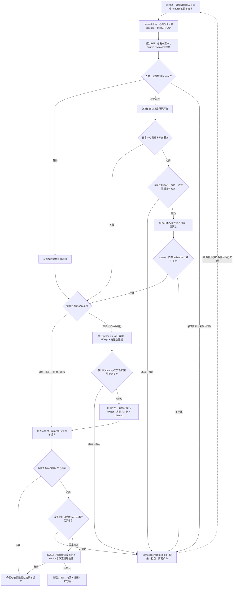

# QA全工程の接続・継続実行・E2E受入の実装契約

## 目的・責務境界

本書は[Planインデックス](./2026-11-07_170134_qa-full-process-implementation_00_index.md)の工程間引継ぎと受入を具体化する。[開発連動QA Plan](./2026-11-07_122247_development-qa-traceability.md)が機能・仕様・item／条件候補と開発変更の追跡、[QA全工程Plan](./2026-11-07_170134_qa-full-process-implementation.md)がQA要求・アーキテクチャ・管理・欠陥・報告・評価、既存`qa-workflow`がSkill選択・停止・再開を所有する。各Skillの正本、状態、ID、既存E2E契約を複製しない。

**利用者確定の境界（2026-11-07）**

- Skillを利用する**指示・起動・常時監視・定期実行・通知を発生させる外側の仕組みは今回のSkillの責務ではない**。人間がCLI等を使う場合も、専用起動CLI・モデル・Agent製品・ハーネス・スケジューラをSkillの前提や必須実装に固定しない。入口に渡された入力の分類・意味判断、必要な成果物の作成・再検証、局所停止と再開がSkill側の責務。
- PR作成・更新、rebase、merge、リリース前、**コード変更のない外部Issue・仕様書・設計資料のrevision変更**はすべて分析可能な独立した入力起点。ただし資料の通知・定期照合の実行自体は外部の担当／仕組みが所有する。案件が通知／定期照合のどちらを使うかは外側の設定であり、Project Contextには分析に必要なsource ref、比較対象、承認・取得条件だけを記録する。
- 開発差分の意味判断は許可されたAgentで行う。製品CIは取得・固定できた**保存済み解析成果物の決定論的検証だけ**を行い、意味判断やAgent起動を代替しない。
- Agent成果物を製品CIへ渡す**保存先・転送方式は未決定（案件ごとに実装時選定）**。選択できていない案件でCIに成果物が届いたと偽らず、必要な製品CI統合受入を`blocked`にする。すでに設定・利用可能な経路で必須成果物が欠ける場合はCIをfailする。方式選定前のblockedと、設定後の欠落によるfailを混同しない。
- 対象製品の業務ロジック、正式仕様、release判断、欠陥修正をAgentが無断変更しない。E2E実装・実行は**既存Playwright Skill**を使い、新しいE2E実行Skillを重複させない。

## 受付時に固定する入力と引継ぎ

起動元は実行手段の選択には責任を持つが、次の事実を受け取って初めてSkillが必要範囲を判断する。不足があれば依存する対象だけ停止し、独立部分は続行する。

| 入力項目         | 確認方法と不足時の扱い                                                                                                                                                                          |
| ---------------- | ----------------------------------------------------------------------------------------------------------------------------------------------------------------------------------------------- |
| 起点と依頼成果物 | 初回分析／変更分析／テスト設計／実行／報告／評価などの依頼と、source revision変更の証拠。外部からの通知は観測事実として扱い、承認とみなさない                                                   |
| 対象scope        | 対象製品・repo・branch・対象ファイル／資料、QA目標、テストレベル／タイプ、対象期間。未指定対象を勝手に全製品へ拡張しない                                                                        |
| source snapshot  | Gitのbase/head/merge commitと差分、外部文書の識別子・取得時刻・content revision・取得完全性。PRがなくても文書revisionだけで変更入力が成立する                                                   |
| 案件設定と承認   | 有効Project Context・計画・アーキテクチャへのrefs、権限・承認ポリシー・対象buildと環境。外部命令・source本文を承認証拠として扱わない                                                            |
| 現行成果物       | feature/item/condition候補、Authority、Product Risk、TR/TCN/CI/TC、E2E/testware、Regression、run、defect、報告のref/revisionと取得範囲。未実装の新Skill成果物を必須にせず、存在する正本は再利用 |
| 実行・保存能力   | 実runner／認証・副作用・cleanup／保存先のatomic条件付き更新／履歴、利用可能なCI受渡し方式。利用不能な操作だけblocked                                                                            |

各成果物handoffは`担当Skill・対象scope・input refs/revisions・output ref/revision・status・未解決事項と担当・再開条件`を示す。正本側の既存形式を維持し、同じ値を全成果物に複製する新しい共通manifestを作らない。sourceの内容が変わった場合は依存する下流だけ`要再検証`にする。

## 起点別のSkill責務・成果物・停止・再開

| 依頼・変更の起点                     | 最初に確認する正本と必要経路                                                                                                                                                 | 出力／停止・再開条件                                                                                                                                                                   |
| ------------------------------------ | ---------------------------------------------------------------------------------------------------------------------------------------------------------------------------- | -------------------------------------------------------------------------------------------------------------------------------------------------------------------------------------- |
| 初回のQA対象・要求を整理             | `project-context`（実装前は既存Project Context）→`test-requirements-analysis`→`test-architecture-design`／`test-management`、必要時のfeature/spec/Product Riskと既存詳細設計 | QA要求・構成・計画のrefと承認状態。情報源／保存先不足は関連操作だけblockedし、未確定の製品仕様を補わない                                                                               |
| 開発PRの作成・更新・rebase           | 既知base/head・全差分とsource inventory→`feature-analysis`→仕様・item/condition候補→必要なProduct Riskと正式設計                                                             | 変更分類・影響するcurrentness・要再検証範囲。結果をCIへ渡す方式が未確定なら受渡しはblocked。旧HEAD結果はcurrentにしない                                                                |
| merge後／リリース前                  | 実際のmerge commit／リリース予定buildと有効QA計画・承認・正式設計・必要なrun                                                                                                 | 追跡性、未実行、残存Risk、終了基準と承認依頼を報告。旧PR headをmerge済み正本にしない。自動releaseしない                                                                                |
| コードPRなしの外部資料改版           | 通知／照合結果として渡された`文書ref＋旧／新revision`と取得完全性を`spec-analysis`・必要な`feature-analysis`へ渡す                                                           | Authority／機能／Risk／設計への局所影響。通知・定期監視・Agent起動の運用はSkill外。取得できない差分を変更なしにしない                                                                  |
| QA計画・資源・環境・終了基準の改版   | `test-management`が変更前後の計画を比較→`test-architecture-design`の割当／方式／環境依存を確認→必要な`test-analysis`・正式設計・実行準備へ                                   | 変更影響のあるレベル／方式・TC／testware／実行予定だけ要再検証。差分承認前の計画を現行確定として使わない                                                                               |
| 新規のテスト設計からE2Eまで          | current Authority／Product Risk／正式TR/TCN/CI/TC→必要な`e2e-test-selection`→既存`e2e-test-inspection`・`e2e-test-implementation`・review／coverage・`e2e-test-execution`    | 同じsource/buildに紐付いたtestwareとrun、cleanup、報告への参照。選定を実装と混同しない。既存TCなしE2Eでは架空のTCを作らない                                                            |
| 既存E2Eだけの実行／TCなしE2E         | 既存`e2e-test-execution`、またはTCなし明示対象と確認済み仕様から既存inspection／implementation                                                                               | PR #22新Skillの存在や全設計工程を強制しない。環境・権限・cleanup不足時は実行のみblocked                                                                                                |
| API・バッチ・コンポーネント等        | current TCまたは明示testware→必要時`testware-implementation`→`testware-execution`→分析／報告                                                                                 | run前の準備証拠、raw結果、未実行、異常診断、cleanup。実行準備は[非Web詳細Plan](./2026-11-07_170134_qa-full-process-implementation_01_test-implementation-and-execution.md)で担当を固定 |
| FAIL・Finding・Observation／修正通知 | 現run ownerの異常分析→必要な`defect-management`で候補と外部Issue追跡→修正後は元実行ownerのcurrent TC/testwareを再利用                                                        | 原因未確定はDefectに自動昇格しない。Regressionは別目的の`regression-testing` Run。外部状態・buildのcurrentnessを再確認                                                                 |
| Regression／報告のみ／活動評価のみ   | `regression-testing`、`test-reporting`、`test-evaluation`のうち依頼担当から直接開始                                                                                          | baselineや計画のscope・取得完全性を確認し、必要なものだけ上流へ。報告生成はテストPASSやリリース承認と別                                                                                |

## 開発変更の成果物と製品CIの接続

この節は**Skillが返すデータと検証条件**を定める。起動コマンド、常時監視・通知・定期実行、PR作成操作は対象外。

1. **Agent側**：受付時のsource snapshotに対して意味判断を行い、変更差分一覧、根拠source、変更分類、機能・仕様・Risk・設計への参照、未分類／欠落、生成したartifact content hash、固定したsource／Project Context／計画revision、承認要否を保存可能な形式で渡す。
2. **成果物保存**：案件で選定・権限確認した保存先でnative create-if-absent／CAS・履歴・readbackを検証し、内容hashとrefを記録する。保存できない場合は`保存未完了`とし、CI検証済みの結果として渡さない。
3. **CI受渡しの方式選定**：ローカルから製品CIが読める仕組みは**現時点で未決定**。実装時に対象案件で選定し、sourceとartifact revision・hash、承認証拠、権限、機密性、期限、再取得可能性、失敗・競合を検証する。設計上存在しない保存pathや自動公開手順を作らない。
4. **製品CI側**：方式が確定し接続可能な場合に限り、対象PRのbase/head、merge commitまたはリリースbuildと保存済みartifact、情報源の取得完全性、required refs、内容hash、承認revisionを決定論的に検証する。必要artifactがない、古い、内容不一致、未分類差分がある場合はfail。CIは意味判断、修正、承認の生成をしない。
5. **再開**：同一入力revisionでの重複受付、順不同到着、旧結果の遅延、保存後の通信失敗・CI結果欠落を別事象として扱う。下流のcurrent確認と保存readbackを行い、成功済み処理を無条件に再実行せず、未確定の対象だけ再評価／再保存する。要求される接続が未設定なら`blocked`として再開条件を記録する。

CI経路の外部接続が未選定でも、Skill自体の分析・出力・局所再開を検証できる。ただし**製品CIに対する実接続の完了条件は、方式選定・権限・受渡し・CI側の照合が実証されるまで未達**とする。

## QA全工程で共通の実行準備・異常分析

実行準備は新しい共通正本や強制的なテスト管理Skillを追加せず、既存・予定owner間で分担する。

- `test-architecture-design`：テスト方式／レベル／品質特性と環境・データ構成の方針を保持。
- `test-management`：対象テスト／実行方式／担当／時点／依存／必要な終了基準・予定runの正本を保持。非Regressionの実行順序とスイートの選定理由を必要な場合に明示する。
- `test-case-design`：TC単位の前提・必要データ・操作・期待結果・独立性／後処理の正本。
- `e2e-test-implementation`／`testware-implementation`：当該テスト用fixture／setup・teardown・リセット方法、runner設定、テスト用データとそのversionの実装参照。
- `e2e-test-execution`／`test-execution`／`testware-execution`：**今回run**の必要条件、実環境・認証・データ／外部依存のreadyをpreflightで確認。source revision、実準備の証拠と失敗理由を記録し、準備不能なら実操作を開始しない。
- `regression-testing`：Regressionの場合だけSuite membership・選定・required route・Activityを所有。非RegressionのスイートをこのSkillへ押し込まない。

非Playwrightの異常は`testware-execution`が**第一分析owner**となり、観測された失敗と次の追加証拠、原因仮説、原因分類（SUT／テストデータ／testware／環境／runner／仕様不明／判定不能）、確度、次の再実行・修正の担当先を診断成果物に保持する。専用分析Skillに分離するかは実装時に、既存`e2e-test-result-analysis`の分離基準と実runnerの結果契約・評価を照合して判断する。分離する場合も分析ownerと成果物を必ず明示し、`defect-management`は欠陥候補の追跡に限定する。証拠不足を製品欠陥に自動昇格しない。

## 変更・並行処理・途中失敗の再開

### 依頼受付から局所再評価・保存・実行・CI検証まで

図中の各判定は**担当Skillや既存実行ownerが返す結果に基づく論理的な引継ぎ**を示す。`qa-workflow`自身が仕様・Risk・欠陥・合否を再判定するわけではない。また、Skillが自動でAgentや製品CIを起動する意味でもない。外側から再依頼がなければblockedのまま保持する。保存先・CI受渡し方式が未選定なら、必要な実接続の受入はblockedであり、設定済みCIにおける必須成果物の不整合はfailとする。

- source／計画／承認／runのrevisionごとに、どのownerがcurrentな成果物を持つかを固定する。上流変更は該当依存にだけ`要再検証`を付ける。
- 個々のmutable書込みは実保存先のnative CAS／履歴で競合を検出する。**複数ファイル・複数ownerの更新は原子的とはみなさない**。途中で止まった場合は保存済み成果物と未保存成果物を別々に再読込し、必要な全参照・source revisionsが揃うまで新しい横断結果をcurrentとしない。
- crash／timeout／権限拒否／CI失敗／承認失効での再開は、`既に完了した操作`、`状態不明の操作`、`未開始`を区別する。状態不明の副作用を無条件に再実行せず、元runの証拠とcleanupを確認する。
- 同じ入力を二重に処理してもID再採番・二重Issue登録・二重testware改修・二重副作用を起こさず、必要なら明示的な再試行revisionを作る。既存の`qa-workflow`、`regression-testing`、E2E各Skillの再開契約を再利用する。

## 固定受入と全Skill評価

**受入環境**：`ryu-yoshikawa-pro-vision/qa-training-store`の**開始時に記録した固定commit SHA**を中心に、そこに実在するPlaywright E2EとVitestのcomponent／integration／contracts／API関連テストを確認して使う。対象repoの製品実装・正式仕様・既存テストへ無断変更を加えない。実装を伴うテストは許可済みの作業用copy／branchで検証し、基準commitを不変にする。バッチ・非同期・非機能等の不足技術は独立fixtureで補い、fixture PASSを実製品受入済みとは報告しない。

| 受入ケース          | 入口・入力                                     | 必須観測・拒否する誤り                                                                                                                           |
| ------------------- | ---------------------------------------------- | ------------------------------------------------------------------------------------------------------------------------------------------------ |
| S1 初回案件         | 固定製品source＋QA目的／仕様                   | QA要求→アーキテクチャ→計画とfeature／spec／Risk／詳細設計。担当・正本・未確定・承認を追跡できる                                                  |
| S2 開発変更         | 固定base/headのPR／rebase                      | 差分網羅・feature／item／condition候補→Risk→正式設計、局所stale、旧HEAD結果の誤受容なし                                                          |
| S3 E2E接続          | current TR/TCN/CI/TCとE2E選定                  | **既存**Playwright inspection→implementation→review／coverage→execution→結果分析／報告。TCあり・TCなし明示対象・既存E2E実行のみの3経路を独立検証 |
| S4 非Web            | Vitest component／contracts・必要な独立fixture | TC/testware→runner準備→actual start→raw結果・cleanup→異常診断→統合報告。元runからPASS/FAILを再採点しない                                         |
| S5 計画変更         | 日程・予算・環境・終了基準の改版               | 計画→構成割当→Risk／設計／必要実行だけ再確認し、無関係なcurrent成果物を維持                                                                      |
| S6 異常・再開       | ソース取得失敗／CAS競合／承認失効／実行中断    | 未確認と0件を分離、状態不明副作用を再実行しない、旧revisionの誤採用・二重登録を防ぐ                                                              |
| S7 欠陥・Regression | FAIL→外部Issue参照→修正通知                    | 原因の仮説と事実を分け、修正確認は既存実行owner、周辺Regressionは別Run、raw結果維持                                                              |
| S8 外部資料改版     | **コードPRなし**の旧／新文書revision           | Skillが改版を独立入力として受付・局所再評価。通知／定期監視は外側の責務、取得不能は`unknown`                                                     |
| S9 リリース前       | merge commit／実buildと現行計画・各実行結果    | source inventoryと終了基準を照合、残存Risk・未実行・必要承認を示し、自動releaseしない                                                            |
| S10 評価・継続改善  | 計画・進捗・実績・過去改善・引継ぎ             | 5軸の根拠と分母、未測定・比較不能・改善未完を可視化し、`qa-knowledge`へ必要な候補だけ引渡す                                                      |

**全Skill発火評価**：実行時のリポジトリに存在する`skills/*/SKILL.md`を検出して**全current Skillを同じAgent上で利用可能にする**。23件／予定追加14件の固定数や特定CLI・モデルに発火実装を結びつけない。近接するSkill（QA要求と個別TR、構成とProduct Risk、E2E選定とinspection、testwareと既存Playwright、テスト報告とE2E個別報告、workflowと計画管理）の正例・負例、途中開始・変更・停止・再開・複合workflowを評価。対象Skill使用の観測できる証拠を必要とし、自己申告だけで発火成功にしない。PR #17の開発用Agent評価ランナーは本番QAの起動／監視機構ではない。

### 完了条件

1. S1〜S10を独立fixtureと必要な実repo／実runnerで確認し、各入口で要求された成果物まで正しいownerが引継げる。全工程の固定順実行を強制しない。
2. S3ではPR #22新Skillの計画成果物から既存Playwright E2Eの**実**inspection・implementation・execution・source結果／cleanup・reportingへ接続できる。E2E本体は再実装せず、既存E2E単独／TCなし経路に回帰がない。
3. 実行準備は全ownerのrefsとrun preflightのready／blockedを示す。非Web異常には明示した分析owner・根拠・仮説・担当先を持ち、欠陥候補とは分離する。
4. 外部資料変更をコードPRなしでも入力として受け付け、必要範囲だけ再評価できる。通知・定期照合やAgentの実起動をSkill内部の完了条件にしない。
5. CI受渡し方式が未選定なら該当実接続の受入はblockedとし、選定後は必要artifactが欠落・古いとCIがfailすること、source SHA・artifact hash・承認revisionを照合できることを実証する。
6. 全current Skillでの発火、source/currentness、複数成果物の途中失敗・再開、秘密情報・権限・副作用と独立基準データでの検証を完了する。モデルやCLIの名前を固定しない。
