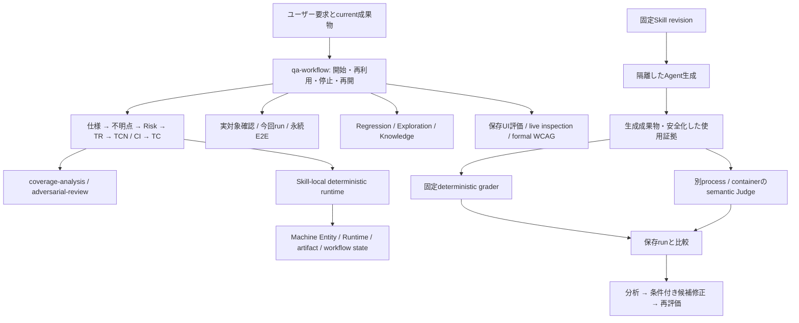

# qa-workflow-skills ワークスペース現状調査・設計レビュー

- 調査日: 2026-10-23 JST（Asia/Tokyo）
- 対象: `C:\Users\sella\Documents\qa-workflow-skills`
- branch / commit: `feat/agent-eval-runner` / `03703f5ec0a281e7c4b86d4af1f0bb51f568e1af`
- 作業範囲: 調査・レビューと本レポートの新規作成。実装・既存ファイル変更・対象repositoryのGit mutation・外部書込みは行わない。

## 1. 総合評価

**分析・設計の決定論的処理と成果物契約は、継続開発の基盤として利用できる。実Agentを使った評価・自動改善の受入は未完了であり、特に修正開始と改善成立の判定を現状のまま信頼してはならない。**

22 Skillは、仕様理解からテスト分析・要求・条件・ケース・網羅性確認までの主経路と、実対象確認、手動相当の実行、Playwright E2E、Regression、Exploration、Knowledge、UI/UX、WCAGへ分担されている。意味判断をAgentへ、構造・ID・計算・鮮度・参照・完了条件の機械検査をSkill-local scriptへ分ける設計は目的に合っている。

今回、runtime 371件（2 SKIP）、repository deterministic 290件、semantic dataset 22 Skill / 163 case、公式Skill構造検証22件が成功した。対象commitのGitHub Actionsも5 workflowが成功している。これらは全Skillの実Agent反復品質や、外部製品の正しさ・WCAG適合を保証しない。

最優先は、Judgeのcriterion検証状態、修正前の原因帰属、修正後の独立回帰を正しく閉じること（F01–F03）。加えて、Planが要求する決定論的失敗だけに基づく改善経路が未接続である（F04）。Linux Docker上の実Agent受入環境の確保も必要だが、環境問題だけを解決して改善機能を受入済みにしてはならない。

| 判定区分                  | 現状                                                                                                                   |
| ------------------------- | ---------------------------------------------------------------------------------------------------------------------- |
| 実装済み                  | 22 Skill、技法generator、成果物と状態helper、grader、semantic runner、Agent/QTS/Judge/改善CLI                          |
| 単体・契約検証済み        | 広い範囲で成立。今回の再実行結果は§2.4。Agent fake suiteはWindowsで6 errors                                            |
| 決定論的統合検証済み      | runtime縦断、UI package移行・部分再実行、routing、WCAG closure等。全実Agent経路とは区別                                |
| 実Agentの限定受入記録あり | PR #11の代表runtime、PR #13の7 semantic candidate、PR #14の代表browser/Agent経路、PR #16の41項目smokeと8 semantic case |
| 現行HEADの実Agent反復受入 | 共通runner全4 smokeでSkill使用未確認、QTS成果物未成立、Judge独立検証・Skill改善実証未達（PR #17報告）                  |

全体の作り直しは不要。通常のQA成果物作成を、入力根拠・対象scope・helper検査・人間の確認を保って利用しながら、評価・改善基盤の不足を限定修正する段階である。P0は確認していない。確定指摘は **P1: 4件 / P2: 2件**。受入不足・環境制限は、コードの不具合と分けて記録した。

## 2. 調査対象と確認方法

### 2.1 Git・環境

| 項目                       | 確認結果                                                                                                                            |
| -------------------------- | ----------------------------------------------------------------------------------------------------------------------------------- |
| Git root                   | 上記Windows path。`/workspaces/qa-workflow-skills`ではない                                                                          |
| 現在branch                 | `feat/agent-eval-runner`                                                                                                            |
| local HEAD                 | `03703f5ec0a281e7c4b86d4af1f0bb51f568e1af`                                                                                          |
| local upstream記録         | `origin/feat/agent-eval-runner`も同SHA。未push commitなし                                                                           |
| GitHub実HEAD               | PR #17のAPI metadataも同SHA。単にlocal tracking refをremote最新と見なしたのではない                                                 |
| default branch             | GitHub repository metadataで`main`。PR #17のbase SHAは`cd51794d464a9a142bdfcf04992bc7b0bb463696`。mainの独立した最新ref SHAは未取得 |
| 開始時working tree         | clean。staged / unstaged / untracked変更なし（ignored local evidence等は存在）                                                      |
| 終了時変更                 | 本レポートのみ。最終確認は§9                                                                                                        |
| Windows PowerShell実行環境 | PowerShell 7.6.7                                                                                                                    |
| Git                        | 2.55.0.windows.5（実行ファイルのProductVersion / FileVersionから取得）                                                              |
| Python                     | 3.11.9。既存`.venv`も3.11.9                                                                                                         |
| Node.js                    | v24.12.0                                                                                                                            |
| 利用可能なCodex CLI        | `codex-cli 0.162.0-alpha.17.2`。実Agent評価は起動していない                                                                         |
| 既存検証ツール             | Ruff 0.16.8、dprint 0.55.2、PyYAML 6.0.3、skills-ref 0.1.0                                                                          |
| Docker                     | CLI 29.9.2。version表示時にuser config読取拒否の警告あり。daemon / Linux runtimeは今回検証していない                                |

ツールは既存配置を使い、依存のinstall・更新はしていない。formatterではcommand単位のPATHだけを調整した。最初のdprint探索失敗後、既存native `dprint.exe`のdirectoryを使うと通常入口が成功した。

`git --version`を含むcommandと`git ls-remote`はrepository PreToolUseが拒否した。拒否を回避する再実行はしていない。Git versionはファイルmetadata、PR HEADはGitHub connectorの読取り結果で確認した。Hookの拒否が観測できたことだけで、fresh embedded runtime全体の受入を主張しない。

### 2.2 参照範囲

Git tracked fileは1169件。構成を列挙し、全22 Skillの責務・dataset inventory、主要Skillの実行契約とreference、runtime入口・validator・対応test・CIを照合した。1169件の全文を逐語監査したわけではない。

- 正本: `AGENTS.md`、`README.md`、`EVALS.md`、`PLANS.md`、`CODE_REVIEW.md`、`.agents/skills/code-review/`。
- 主経路: `skills/{spec-analysis,question-analysis,test-analysis,test-requirement-design,test-condition-design,test-case-design,coverage-analysis,adversarial-review,qa-workflow}/`。
- 実対象・実行: `test-target-inspection`、`test-execution`、5つの`e2e-test-*`。
- 継続QA: `regression-testing`、`exploratory-testing`、`qa-knowledge`のSkill・production helper・データ契約。
- UI/WCAG: `usability-evaluation`、`usability-inspection`、`wcag-conformance-evaluation`、fixed browser probes、versioned catalog、EARL、QA owner側SQLite closure。
- 評価: `scripts/skills/evals/{deterministic,semantic,agent}/`、全Skillのeval manifest、Judge fixture、QTS scenario、`tests/skills/`。
- 開発基盤: `.codex/{config.toml,agents,hooks,rules}`、`tests/codex/`、`.github/workflows/`、formatter・lint設定。
- 文書: `docs/PROJECT_CONTEXT.md`、`docs/reference/codex-safety-harness.md`、既存2 report、主要root Planと関連分割Plan。特にPR #11–#18で導入した契約と現在の実装経路を照合した。
- ignored evidenceは、既知の受入記録・PR #16 final manifest・Step 9 matrixの必要な項目とhashだけを確認。cache・依存・出力directoryの一括内容走査はしなかった。

外部仕様は[Agent Skills Specification](https://agentskills.io/specification)のpackage構造・段階的読込みと、[Playwright Locator公式API](https://playwright.dev/docs/api/class-locator)の既存操作機能を参照した。独自のSkill間実行APIやbrowser観測値の自動保証を外部仕様から仮定していない。各製品・全WCAG条項の外部仕様再監査は今回の範囲に含めていない。

### 2.3 GitHub・Plan・既存結果

2026-10-23 JSTのconnector取得ではopen Issueは0件、open PRは[#17](https://github.com/ryu-yoshikawa-pro-vision/qa-workflow-skills/pull/17)と[#10](https://github.com/ryu-yoshikawa-pro-vision/qa-workflow-skills/pull/10)。検索結果の範囲であり、非公開の管理課題がないことまで意味しない。

| PR / Plan                   | 現在確認できた状態と証拠の限界                                                                                                                                                   |
| --------------------------- | -------------------------------------------------------------------------------------------------------------------------------------------------------------------------------- |
| #10 Skill同期batch          | open。PR本文はPlan完了・実装未着手。記載Planは現在branchに存在せず、別branchの実装内容は調査していない。現在checkoutの機能とは数えない                                           |
| #11 決定論的runtime         | README / Project Context / Planに、当時24 semantic caseと代表runtime smokeの記録。今回の現行HEAD全実Agent受入へ拡張しない                                                        |
| #13 Artifact Graph          | 既存reportに7 candidate + Judge PASS、修正後REG-SEM-004再評価の記録。native CAS等のない保存先はblockする設計を確認                                                               |
| #14 UI/UX・inspection・WCAG | APIではmerged。最終head `763f01dcd3ec8426efd0f2ce424beb82e11d1f98`。代表受入と標準検証でrepository実装を完了、83 case全量semantic反復は#17へ移管。native trigger全量統計は別課題 |
| #16 UI対象分析mode          | APIではmerged、最終head `0202b12fab82358eb470057689080cd99fec2020`。PR本文は8 case / 36 criteria PASS、Step 9 41/41 PASS。local final manifestのSHA-256はPR記載値と一致          |
| #18 formatter / harness     | APIではmerged、head `81e5f5eef0f4d63192d8d2b87b33f94a158a293c`。実装完了とfresh runtime qualificationを分離する改訂契約。後者は未確認                                            |
| #17 Agent runner            | open。root Planと`_02` QTS、`_03`改善、`_04`Judgeを確認。fake実装検証とlive受入未達を分離。F01–F04の実装不整合がある                                                             |

PR #16のlocal Step 9 matrixは41 PASS、`step9_complete=true`で、verification headは`8b773b380af5e0cd120fff0c83602f73d8aa3261`。current HEADの再実行結果ではない。semantic final manifestはSHA-256 `96522e65d0f4b8703c2bb7365001bdcca29ec8987ef539e576db644029041caa`、8 case / 36 criteria PASS。原成果物すべてのhash連鎖や現在sourceへの再適用性まで今回再検証していない。

PR #17本文の「remote `691a34a` / local `03703f5` ahead 1、local CIなし」は現在metadataと不一致。現在HEAD `03703f5`には以下のsuccessが存在する。

| Workflow                            | 対象commitのrun                                                                                        |
| ----------------------------------- | ------------------------------------------------------------------------------------------------------ |
| Validate Agent Skills               | [39809513941](https://github.com/ryu-yoshikawa-pro-vision/qa-workflow-skills/actions/runs/39809513941) |
| Validate Deterministic Output Evals | [39809513879](https://github.com/ryu-yoshikawa-pro-vision/qa-workflow-skills/actions/runs/39809513879) |
| Validate Semantic Output Evals      | [39809513862](https://github.com/ryu-yoshikawa-pro-vision/qa-workflow-skills/actions/runs/39809513862) |
| Code Quality                        | [39809513911](https://github.com/ryu-yoshikawa-pro-vision/qa-workflow-skills/actions/runs/39809513911) |
| Codex Harness                       | [39809513853](https://github.com/ryu-yoshikawa-pro-vision/qa-workflow-skills/actions/runs/39809513853) |

Codex HarnessはLinux contract / Windows launcherの両job successも確認。取得toolは対象commitのPR-triggered runのfirst pageを返すため、全branch・全eventの最新履歴を網羅したとはしない。

### 2.4 今回実行した検証

各行は別commandとして実行・exit codeを判定した。Python unittestは既存`.venv/Scripts/python.exe -B`を使用。testが内部で一時fixtureや一時Git repositoryを作る場合は既存testの挙動であり、対象repositoryのbranch / index / refsは変更していない。

| 検証入口                                                                          | 今回の結果                                                                                     |
| --------------------------------------------------------------------------------- | ---------------------------------------------------------------------------------------------- |
| `unittest discover -s tests/skills/runtime -p 'test_*.py' -q`                     | 371件、OK、2 SKIP、約161秒                                                                     |
| `unittest discover -s tests/skills/evals/deterministic -p 'test_*.py' -q`         | 290件、OK、約93秒                                                                              |
| `unittest discover -s scripts/skills/evals/deterministic/tests -p 'test_*.py' -q` | 13件、OK                                                                                       |
| `scripts/skills/evals/semantic/validate.py`                                       | 22 Skill / 163 case、exit 0                                                                    |
| `unittest discover -s scripts/skills/evals/semantic/tests -p 'test_*.py' -q`      | 27件、OK、2 SKIP                                                                               |
| `unittest discover -s tests/skills/evals/semantic -p 'test_*.py' -q`              | 13件、OK、1 SKIP                                                                               |
| `unittest discover -s tests/skills/evals/trigger -p 'test_*.py' -q`               | 1件、OK。実Agent trigger評価ではない                                                           |
| `unittest discover -s scripts/skills/evals/agent/tests -p 'test_*.py' -q`         | 44件、FAILED、6 errors。F05参照                                                                |
| `unittest discover -s tests/skills/evals/agent -p 'test_*.py' -q`                 | 4件、OK                                                                                        |
| `unittest discover -s tests/codex -p 'test_*.py' -q`                              | 55件、OK、約178秒。CLI 0.162.0-alpha.17.2を使用。fresh interactive受入とは別                   |
| formatter contract / patch whitespace contract                                    | 10件 / 3件、いずれもOK                                                                         |
| `scripts/format_tracked.py check`                                                 | Ruff check・235 Python filesのformat・dprint checkがexit 0。初回dprint探索失敗は解消して再実行 |
| `ruff check --no-cache scripts/skills/evals/agent`                                | exit 0                                                                                         |
| 既存`skills-ref validate`を各`skills/*`へ個別適用                                 | 22/22 exit 0。UTF-8設定で実行                                                                  |
| `node --check .codex/hooks/pre_tool_use_policy.mjs`                               | exit 0                                                                                         |
| F01–F03の読取り専用Python診断                                                     | synthetic JSON・mock・実sourceのgate式で確認。外部Agentなし、診断用fileなし                    |
| `git diff --check`                                                                | レポート作成前exit 0。レポート自身は作成後に別途検査                                           |

SKIPはWindowsのsymlink権限条件を持つテストを含む。SKIPした経路をPASS件数に含めて保証しない。実Agent生成・Judge API・Docker build/run・browser live・全量trigger・高コスト評価は起動していない。

## 3. ワークスペースの構成

### 3.1 directoryと役割

| 領域                                          | 役割                                                                                                                      |
| --------------------------------------------- | ------------------------------------------------------------------------------------------------------------------------- |
| `skills/`                                     | 22の配布単位。SKILL、reference、assets、必要なproduction script、trigger/output/semantic dataset、deterministic validator |
| `scripts/skills/evals/deterministic/`         | 共通Markdown parser、validator loader、runtime evidence検査、保存済み出力のgrade                                          |
| `scripts/skills/evals/semantic/`              | dataset loader、Judge prompt、厳密JSON検証、criterion / verdict正規化、CLI                                                |
| `scripts/skills/evals/agent/`                 | revision展開、隔離preflight、Agent生成、QTS、独立Judge、比較・分析・修正候補保存                                          |
| `tests/skills/`                               | runtime、出力契約、semantic/trigger dataset、Agent repository integration、canonical browser fixture                      |
| `.codex/`・`.agents/`                         | 開発Agentの設定、Hook、execpolicy、4 role、Plan/review/repairの開発Skill                                                  |
| `.github/`                                    | 5 workflowとpatch whitespace検査                                                                                          |
| `docs/`                                       | Project Context、設計・実装Plan、過去report、安全ハーネス仕様                                                             |
| `.agent-eval-runs/`・`.artifacts/`・`output/` | ignored評価・受入証拠・一時成果物。tracked sourceと別管理                                                                 |
| `.venv/`・各cache                             | 既存local実行環境。内容の全面監査や変更は対象外                                                                           |

### 3.2 Skill・Agent・Evaluatorの接続

`qa-workflow`はAgentが使うオーケストレーション契約であり、全Skillを自動実行する汎用schedulerではない。runtimeの`can_complete`はsemantic coverage、実際の実行、cleanupを代替しない。単独のSkill開始やTCなしの明示E2Eも許され、全工程の強制実行はしない。

### 3.3 成果物・ID・状態

- LLMのnormalized JSONを、標準ライブラリ中心のSkill-local generatorが処理。strict decode、型付きexact number、canonical化、入力・model・generation fingerprint、stable target IDを使う。
- Authority / Risk → TR → TCN / Model / CI → TCの直接参照を維持し、coverage側でorphan・参照型・disposition・closureを検査。意味上の妥当性はsemantic評価・reviewに残す。
- UI packageはscope readiness、UNKNOWN、履歴ID、変更versionを管理。`migration_preflight.py` → downstream ownerのcutover → `downstream_state.py` → generator → coverage → final workflow gateへ接続する。
- partial rerunはprevious artifact、inactive history、scope ownershipを検証。全scope blocked、全scope retired、再readyを別経路にする。成功したqa-workflow artifactだけをexact historical bindingとして保持する。
- `artifact_graph.py`はProject Context stable key、state、currentness、claim、reservationを所有する。一般のlocal filesystemでnative CAS / conditional releaseがなければblockする。local baseline限定のlock・snapshot処理やWCAG限定SQLite providerとは保証範囲が異なる。
- 9 packageの`runtime_contract.py`は今回raw hashがすべて同一。独立配布のための同梱であり、コピー数だけを欠陥としない。portability・一致テストを維持する方が、runtime時にrepository外の共通packageを必須化するより現在の配布契約に適合する。

## 4. 機能別の現状評価

| 機能群                            | 目的・実装と検証状況                                                                                                                                     | 残課題 / 利用条件                                                                             |
| --------------------------------- | -------------------------------------------------------------------------------------------------------------------------------------------------------- | --------------------------------------------------------------------------------------------- |
| spec-analysis / question-analysis | Authority、UI対象package、Behavior/AC、UNKNOWNと回答・再開。UI helperのstaging/rollback、履歴・readinessを実装。PR #16限定Agent証拠と今回runtime回帰あり | あいまいな意味・owner・未回答をhelperが解決するわけではない。移行順序とbaseline lineageを保つ |
| test-analysis                     | Entity、Risk matrix、技法候補、change impact、environment requirements。決定論的検査と意味判断を分離                                                     | Risk評価や技法適用の意味的品質は対象入力ごとに必要。全Agent統計は未確認                       |
| TRD                               | 検証責務、Authority / Risk / AC closure、scope、stable TR履歴。artifact modeでcurrent AC集合との一致検査あり                                             | AC・Authorityの意味をTRへ写した妥当性はJudge/reviewに残る                                     |
| TCD                               | EP、BVA/Domain、Decision/Cause、CRUD、Grammar、組合せ/分類木、状態/フロー、Random/Metamorphic、Schema/UI、TDR、materialize。exact型・seed・探索上限あり  | unsupported・stale・semantic CI不足は未完。巨大な全列挙を黙って縮小しない設計を維持           |
| TC                                | current TCN/CI/ENV/DATAから詳細TC、stable ID、scope更新。source Entityとの一致と要求違反を検査                                                           | 期待結果の正しい具体化・第三者が実施可能かは意味評価が必要                                    |
| coverage / adversarial-review     | 決定論的なgraph・鮮度・閉鎖と、独立した意味上の漏れ・過剰・根拠不足を分担                                                                                | 参照がつながっただけで意味上のcoverage完了とはしない                                          |
| qa-workflow                       | routing 69 fixture、scope-based readiness、部分進行、変更伝播、last-completed binding、最終gate                                                          | 同一clientに必要Skillとtoolが必要。routing fixtureを実Agent Skill遷移と同一視しない           |
| 実対象確認 / 今回TC実行           | current target資料とGiven/When/Then snapshot、実測結果・副作用・cleanup、再実行lineage                                                                   | browserは既存Playwright経路。未導入時はblock。今回live targetは実行していない                 |
| 5 E2E Skill                       | inspection、実装、正式runner実行、原因分析、報告を分割。logical/resolved/attempt、raw outcome、server ownershipを契約化                                  | 対象repo固有のrunner・fixture・認証・副作用上限が必要。汎用E2E実行serviceは提供しない         |
| Regression                        | baseline/currentness、membership、Run、全required routeのactual start、結果raw投影、Activity更新                                                         | native conditional write不在時の更新はblock。単なるFAILをDefectへ昇格しない                   |
| Exploration                       | Charter、Observation/Finding、side-effect予算、unknown attempt、cleanup/resume                                                                           | 未観測を仕様化せず、既存execution ownerを迂回しない                                           |
| Knowledge                         | semantic identity、canonical ref、fixed-root scan、triage、lifecycle、currentness、atomic create                                                         | 更新・置換・履歴refetchはprovider能力依存。一般local FSで全lifecycleが完結するとはしない      |
| UI/UX / live usability            | 保存evidenceとlive観測を分離。fixed probe・measurement・population・HMAC document identity・ACT subsetを実装                                             | 固定probeの成功だけで複合UX問題を解決済みにしない。外部対象・browser組合せの網羅受入なし      |
| WCAG / EARL                       | versioned requirement / procedure、sample、variation/process、current results、QA owner実行・SQLite CAS/readback、正式closureとEARL                      | fixtureの部分結果は製品適合を証明しない。manual/AT等の観測不足をcompleteへ昇格しない          |
| deterministic / semantic評価      | 46 output case、163 semantic case、strict Judge JSON、非critical fail等のneeds_review判定、固定Reference                                                 | dataset構造成功はcandidate品質成功ではない。既存実評価は特定caseとrevisionの証拠              |
| Agent runner / QTS                | 固定Evaluator、任意Skill revision、隔離profile、sanitized target、Verifier replay、workflow/artifact別Judge、attempt保存を実装                           | QTSは固定1 scenario / Web Checkout・Payment。live受入未達。F01–F04                            |
| Judge / Skill改善                 | 承認fixture、tune/independent、候補patch、許可path、比較とreview pendingを実装                                                                           | fixture approved 0。検証集約・帰属・回帰gateに不整合。決定論的単独経路も未接続                |
| 開発harness                       | Hook・execpolicy・granular approval、protected branch guard、4 role、formatter/lint                                                                      | roleはhard sandboxではない。managed/shared sessionや全shell構文の安全性を保証しない           |

## 5. 設計・実装の確認結果

### 5.1 アーキテクチャ・正しさ

主経路の責務は明確で、Skill間の契約はgenerator・Machine Entity・verifier・workflow gateへつながっている。UI packageのscope進行、inactive/deleted履歴、WCAGのowner側再実行と保存済みstate照合など、文書だけで完了を自己申告しない仕組みがある。今回のruntime・deterministic回帰でも、その接続を支持する結果を得た。

意味判断そのものをscriptで完全検査できるという設計ではない。semantic normalizerはJSON形式・criterion集合・rating整合を厳密に扱うが、Judgeの判断の正しさは別問題。その別問題を改善許可に結び付ける集約とgateが弱く、F01–F03の修正が必要である。

### 5.2 セキュリティ・データ保護

Agentへ渡す通常Skill sourceから`evals`を除き、Evaluator-onlyのReference/graderをmountせず、Agent/Judgeを分離する設計は妥当。output-only write、read-only root、capability drop、no-new-privileges、profile/image fingerprint、negative probe、secret-shaped textの安全化と採点停止もある。QTSではartifact Judgeへfinal stdout・routing・機械要約を渡さず、最終回答で成果物の欠落を救済しない設計を確認した。

一方、PR #17のCodespaces診断は今回のWindows workspaceへ原証拠が揃っていない。bwrapのseccomp/procfs失敗、host shell negative test未成立、bridge egress残留リスクはPR本文の報告として扱う。sandbox無効化を改善案にはしない。一時認証home、same-user process、egressの実効境界は受入環境で改めて証明する必要がある。

実認証情報・user認証fileの内容は読んでいない。sourceのsecret-pattern対策を確認したが、全履歴の秘密検出・依存脆弱性scanはしていないため、「認証情報漏洩なし」「全依存安全」とは断定しない。

### 5.3 保守性・過剰設計

canonical JSON、stable identity、freshness、CAS、reservation、formal WCAG closureは現存要件から必要性を説明できる。これらを一般的なformatterやschema libraryだけに置き換える提案はしない。QTSのartifact/runtime/semanticを分けることも、評価漏れ・自己採点防止のため必要である。

`runtime_contract.py`、UI package helper、QA artifact graphは大きいが、長さだけでは分割を推奨しない。まずF01–F04の状態と責務を既存helperへ正しく接続し、独立検証を加える。一般storage adapter、中央scheduler、Graph DB、新しい評価frameworkを先行追加する根拠は見つからない。

### 5.4 テスト・CI

unit/contractはstrict JSON、numeric、ID、schema、freshness、partial rerun、atomic保存条件、workflow、false PASS、出力正規形等を広く検査する。fixtureは期待routingとcandidateを分離し、fake Judgeは外部APIなしでprotocolを検査する。重要な負系を持つ点は評価できる。

ただし、改善suiteはfailure抽出・path allowlist等の局所テストが中心で、Judge全関連fixtureの判定集約、代替原因が残る修正開始拒否、独立回帰なしの成功拒否が不足する。44 fake testsがLinux CIで成功しても、この判定漏れは防げない。Windowsの6 errorsはF05。

semantic dataset検証と同じshared/repository semantic suiteはAgent Skills・Deterministic Output・Semantic Outputの3 workflowで重複する。Deterministic Output内には複数validationを1 stepへまとめた箇所もある。現在は独立Semantic workflowの対応stepも成功しており、これを現行false PASSと断定しない。CI整理時は検証ownerと独立exit判定を残す。今回のテスト実行は各commandを個別判定した。

### 5.5 文書

README / EVALS / Project Contextの22 Skill、46 output、163 semantic、69 routingの構成は実manifestと整合。全triggerは488 query。Agent READMEにLinux Docker・既存PyYAML・固定image・auth・probe・run・Judge・改善の入口がある。

過去reportとPlanは詳細な履歴を保存している反面、末尾の未同期・未完了が現在のPR metadataと食い違うものがある。F06で扱う。古い「未完了」を現在不具合と誤認したり、過去PASSを現行HEAD全体の受入へ読み替えたりしないことが必要。

## 6. 改善点一覧

### 6.1 優先順位表

| ID  | 優先度 | 問題                                                               | 主な箇所                                             | 推奨順         |
| --- | ------ | ------------------------------------------------------------------ | ---------------------------------------------------- | -------------- |
| F01 | P1     | 関連fixtureの失敗・不足があってもJudge criterionをverifiedにできる | `agent/improve.py:74–88`                             | 1              |
| F02 | P1     | 原成果物に基づく原因確認・代替原因の解消なしで修正開始gateを通せる | `agent/improve.py:612–651,748–760`                   | 2              |
| F03 | P1     | 別case回帰・関連contract検証なしで改善実証を成立させる             | `agent/improve.py:351–430,1049–1105`                 | 3              |
| F04 | P1     | 決定論的失敗だけに基づく独立改善経路が実装にない                   | `agent/improve.py:91–180,500–524,1146`               | 4              |
| F05 | P2     | fake Agent/JudgeテストがWindowsでLinux依存の6 errors               | `agent/tests/test_*launcher.py`、`test_workspace.py` | 独立対応可     |
| F06 | P2     | 現在状態と過去の同期失敗記録を判別する最終状態が文書に欠ける       | PR #17本文、PR #16 root Plan:419                     | 最終状態確定時 |

上表の`agent/`は`scripts/skills/evals/agent/`。F01–F04は同じfileでも原因と修正条件が異なるため分離した。今回の新規確定指摘が評価・改善側へ集中したのは、主経路を調べなかったためではなく、そこでPlanと実挙動の不整合を確認できたためである。

### F01 — P1: Judge criterionの検証済み判定が関連fixtureの失敗を無視する

1. **対象:** `scripts/skills/evals/agent/improve.py:74–88`、`151–180`。対照仕様はJudge Plan `_04:35–40`。
2. **根拠:** `_judge_verification_map()`はcase単位で`status == verified`のcriterionを辞書へ追加するだけで、同criterionの正常例の誤検出、別違反例の失敗、pending、未実施を集約しない。後続`_stable_failures()`は辞書にあることを修正対象選定の条件にする。
3. **確認:** synthetic保存結果で`normal-artifacts=label_or_judge_mismatch`、`major-violation-006=verified`を同時に与えると、`QTS-SEM-006`はverified辞書へ入り、2回rating 1のbaselineが修正対象へ選ばれた。実関数を用いた読取り専用診断。live Agent修正は起動していない。
4. **発生条件・影響経路:** 一部だけ承認/実行成功したJudge検証、正常例と違反例が食い違うrun、`max_cases`等による部分検証を改善入力にする場合。正常例しかverifiedでない場合も十分な違反検出証拠があるように扱える。
5. **目的への影響:** Judgeの誤判定や不足をSkill欠陥へ変換し、評価・改善の独立性を損なう。現在approved fixtureは0なので実害発生を確認したわけではないが、承認後の通常経路で顕在化する。
6. **推奨:** 既存catalogからcriterionごとの必須正常/違反fixture集合を導出し、全関連証拠・承認・反復一致を満たす場合だけverifiedにする。失敗/不足はそのcriterionだけblockする。
7. **変更範囲:** Judge検証結果のcriterion集約、改善側読込み、対応contract test。新しいJudge/frameworkは不要。
8. **リスク:** 1件の失敗で全criterionを無効化しない。既存のdataset / profile / evaluator bindingを維持する。
9. **検証:** 正常誤検出、違反見逃し、部分run、pending、矛盾、全件正常、および無関係criterion継続の負正系。
10. **概算:** 小〜中（1–2人日目安）。既存catalog/result schemaの再利用を前提とする実装者向け概算で、正式見積りではない。

### F02 — P1: 修正開始gateが未解消の代替原因と原成果物不在を許す

1. **対象:** `improve.py:612–651`（分析入力/workspace）、`202–242`、`748–760`（許可gate）。改善Plan `_03:140–148`が、具体的違反とSkill指示の対応・代替原因除外を要求する。
2. **根拠:** 分析Agentへ渡すartifact情報はpath/hashの組とJudge evidence文字列で、原QA成果物や固定target仕様の本文をworkspaceへ配置しない。workspaceはSkill source中心。許可gateはclassification、候補Skill、path、既知path/hashを含む文字列を確認するが、`alternative_causes`の未解消状態や選択Skillのbaseline使用観測を条件にしない。
3. **確認:** `_validate_analysis()`を通した`alternative_causes=[AgentがSkillを読まなかった可能性を除外できない]`の応答を、実sourceから抽出した`mechanically_allowed`式へ与えると`True`。原artifact本文は与えていない。診断はgate式の動作を確認したもので、完全なlive修正成立の再現ではない。
4. **発生条件・影響経路:** 反復failとpath/hashが揃い、分析Agentが`classification=skill`を返す一方で、Agent不使用・指示無視・入力/証拠問題を除外できていない場合。
5. **目的への影響:** hash参照は内容を調べた証拠ではない。根拠の不足した候補修正を開始し、Skillに原因がない失敗へ余計な変更と評価コストを発生させる。後段で使用観測不足を検出しても、開始前の帰属契約は満たせない。
6. **推奨:** 既存のsanitized原成果物と必要な公開仕様抜粋を読取り専用分析入力へ結び、具体的違反・source箇所・反証結果を検査可能な形で記録する。未解消の代替原因や必要な使用証拠不足は修正前にreview pendingへ送る。自己申告の確信度で補わない。
7. **変更範囲:** 分析evidence package、分析schema、許可gate、prompt、関連fake test。Evaluatorの隠し期待値や独立回帰caseは分析Agentへ渡さない。
8. **リスク:** 原成果物の秘密情報とReference漏洩に注意。必要なsafe evidenceだけを渡し、根拠不足時は修正を始めない。
9. **検証:** 未使用Skill、未解消Agent/input原因、hashだけの根拠、file内容不一致を拒否し、原成果物の具体的違反と単一Skill原因が揃う正系だけ開始する。
10. **概算:** 中（2–4人日目安）。安全なevidence最小単位と既存保存形の接続が主な不確定要素。

### F03 — P1: 独立回帰・通常契約検証をせず改善実証を成功にできる

1. **対象:** `improve.py:351–430`、`1049–1105`、`1130–1133`。改善Plan `_03:131–136,159–162`が別caseと既存契約の確認を要求する。
2. **根拠:** 候補は固定QTS scenarioを2 attempt再評価するだけ。`_assess_improvement()`は対象ratingの1→3以上、同scenario critical rating非悪化、Skill read観測から`improvement_demonstrated`を計算する。別Eval Inputの結果や関連unit/runtime/deterministic契約の結果を要求せず、run全体とCLI exit 0へ伝播する。
3. **確認:** 比較可、使用観測あり、2 attemptでrating 1→3の入力では、別case/通常test結果を一切渡さず同関数が`improvement_demonstrated=true`を返した。実QTS生成や修正は行っていない。source全経路にも別case評価/関連test起動は見当たらない。
4. **発生条件・影響経路:** 特定Checkout/Paymentに合う文言追加やgenerator変更が同scenarioを改善する一方、他入力やstandalone契約を壊す場合。
5. **目的への影響:** 固定案件への適合を、Plan所定の検証を満たした改善へ昇格できる。たとえば9 packageの一つだけで共通runtime契約を変えても、その一致/移植性testを改善経路で閉じない。
6. **推奨:** 候補作成前に独立caseを固定し、候補固定後に既存runnerでbaseline/candidateを比較。関連contract検証も別々に保存し、成功判定へ必須接続する。対象scenario内の進歩は別の部分状態として保持する。
7. **変更範囲:** 改善orchestration、assessment result schema、既存runner/validationの接続、偽成功を拒否するtest。新benchmarkや第二のgraderは不要。
8. **リスク:** 回帰caseの期待値・個別結果を修正Agentへ反復開示しない。元々failのcaseは新規回帰と区別。実行不能は未検証として残す。
9. **検証:** 同scenario改善＋別case悪化、関連test失敗/未実行、case不足、全条件成立を個別確認。局所進歩と全受入成立を区別する。
10. **概算:** 中（3–5人日目安）。既存runnerの接続は可能だが、安全なcase固定・provenance・実行予算制御が必要。

### F04 — P1: 決定論的根拠だけで進められる改善経路が未接続

1. **対象:** `improve.py:91–180,500–524,1146`。親Plan `1110`、改善Plan `_03:142,154`は、決定論的根拠だけの独立案件をJudge未検証で止めないことを要求する。
2. **根拠:** 入力は固定QTS target revisionに限定され、`_attempt_data()`は各attemptの`judge-result.json`とnormalized semantic criteriaを必須にする。runtime verifier / workflow runtimeがpassでないbaselineも全体拒否する。候補抽出は`_CRITERION_SKILLS`のQTS-SEMとJudge verified辞書だけ。CLIでもJudge検証結果が常に必須。
3. **確認方法:** entry → baseline検証 → `_attempt_data()` → `_stable_failures()`の静的追跡。common runnerのdeterministic `grade.json`からこの抽出へ接続するbranchはない。決定論的案件を通すlive実行はしていない。
4. **発生条件・影響経路:** 固定graderで同じ構造/参照/機械品質違反が反復するが、semantic Judgeが未承認・利用不能の場合。common deterministic runもそのまま受け付けない。
5. **目的への影響:** 意味判断不要の修正まで停止する。評価エラーとSkillの決定論的欠陥を分け、独立案件を継続する目的が未達。
6. **推奨:** 既存`grade.json`/fixed expectedを用いるevidence種別を明示し、semantic依存時だけJudge確認を要求する。環境/証拠/validator実行失敗は引き続き修正対象から除外する。
7. **変更範囲:** 入力adapter、failure選定・案件分類、判定根拠provenance、F03と共通の再評価接続、回帰test。
8. **リスク:** 不正な成果物やruntime未実行をすべてSkill欠陥扱いしない。定義済み機械品質違反と環境・証拠不足を区別する。
9. **検証:** Judgeなしで成立する機械品質案件、Judge必須の意味案件、両方依存する案件、環境/証拠エラーを個別に確認する。
10. **概算:** 中（3–5人日目安）。F03の受入結果schema確定後がよい。Plan側の対象削減で解消したことにはしない。

### F05 — P2: fake suiteがWindowsで6件errorになる

1. **対象:** `agent/tests/test_codex_docker_launcher.py:143,248,267`、`test_codex_judge_docker_launcher.py:137`、`test_workspace.py:96,149`。
2. **根拠・実行証拠:** 既存の44件suiteをPython 3.11.9 / Windowsで実行し6 errors。3件はlauncherのLinux host制約、1件はshebang付きfake dockerをWin32実行してWinError 193、2件はmock済みprobeでも`os.getuid/getgid`が存在せずAttributeError。
3. **発生条件・影響経路:** READMEのfake unittest入口をWindowsで実行。実Linux Dockerを利用しないprotocol検証でもOS依存が残る。
4. **目的への影響:** 日常開発でAgent基盤の検証が赤くなり、実不具合との切分けと再現性が落ちる。Linux専用production launcherをWindowsで動作させる要求ではない。
5. **推奨:** protocol部分はOS/UID/subprocess境界をmockし、実Linux launcherの統合部分だけ明示skipまたはLinux専用suiteへ分ける。productionのLinux制約は維持する。
6. **変更範囲:** 上記testのfixture/mocksとREADMEの検証範囲。必要なら既存CIに軽量Windows fake検証を追加。
7. **リスク:** 全テストskipでerrorを隠さない。fakeで検証した条件と実Docker negative testを混同しない。
8. **検証:** LinuxとWindowsで同protocolの正負系が動き、Linux実動作を要するものだけ理由付きskipになること。
9. **概算:** 小（0.5–1.5人日目安）。既存fake subprocessの差替え範囲に依存。

### F06 — P2: 最新状態と履歴の境界が文書に残っていない

1. **対象:** PR #17本文の冒頭/最終GitHub状態、`docs/plans/2026-10-01_201500_ui-test-target-analysis-mode.md:407–419`、PR #14/#18本文末尾。
2. **根拠:** #17本文は`03703f5`未push/CIなしとするが、API headは同SHAで5 workflow success。#16 root Plan末尾は同期拒否・PR全体未完了・head `52658edd`のままだが、現在APIでは`0202b12`でmerged、本文は36 criterion/41 smoke成立。#14/#18もAPIはmergedだが本文にopen/未mergeが残る。
3. **発生条件・影響経路:** 新規Agent/開発者がPlan末尾やPR本文を現在状態の正本として再開判断する場合。
4. **目的への影響:** 既完了作業の再実施や、実Agent受入未達と単なる同期記録の古さの混同を招く。mergedだからlive受入まで完了と解釈することも避けたい。
5. **推奨:** 歴史記録を残し、各active Plan/PR先頭に「確認日時・実装head・CI対象head・実Agent受入状態・証拠参照」の短い最新状態を置く。既存Planとreportへの参照で足り、別DBや重複した長文台帳は不要。
6. **変更範囲:** 将来の明示依頼時に該当Plan/PRの状態要約のみ。本調査では変更していない。
7. **リスク:** 過去のFAIL/拒否を削除しない。同期完了で実Agent受入まで達成したように書かない。
8. **検証:** API metadata・当該commit CI・Plan条件と要約を照合し、historical/currentが判別できること。
9. **概算:** 小（0.5人日前後）。raw evidence再評価は別作業。

## 7. 未確認事項

| 未確認事項                                                 | 理由・必要な確認                                                                                                |
| ---------------------------------------------------------- | --------------------------------------------------------------------------------------------------------------- |
| 現行HEADの実Codex 4 smokeでSkillが実使用されたか           | PR本文は全件unverified。今回外部Agentを起動していない。成功したshell readと成果物採用を区別して確認する必要あり |
| QTS 2 attemptのcanonical QA成果物・意味品質                | PR本文ではartifact-indexなし/Judge未実行。Codespaces側のraw runを今回独立再監査していない                       |
| Codespaces bwrap失敗の現在再現性                           | host kernel/seccomp/procfsの診断はPR報告。現在Windows environmentでDocker変更/再実行はしていない                |
| 認証・egress・same-user境界の実効安全性                    | 設計・source確認に限定。secret fileを読まず、negative testは未実行                                              |
| 全semantic 163 caseの実Agent反復・全trigger488 queryの統計 | dataset検証のみ。#14全量移管とtrigger別責務を区別。実行コストの制約あり                                         |
| Judgeの独立正解品質                                        | fixtureはhuman pending 9 / deterministic pending 2、approved 0。独立承認を今回代行していない                    |
| PR #16 evidenceの完全なcurrent-source再認証                | final manifest hashとmatrix要約を確認。全原artifact/current helper hashの連鎖は再検査していない                 |
| 外部製品/実アカウント/ATのUI・WCAG受入                     | canonical fixtureの結果から保証できない。対象製品の権限・範囲・環境が必要                                       |
| generic保存先でのKnowledge更新・reservation回復            | native CAS等がない場合blockは仕様どおり。利用者が使うproviderの実能力は今回対象なし                             |
| fresh embedded / non-shared Codex runtime qualification    | CLI versionとcontract/Hook観測だけでは受入にならない。managed/shared runtimeを受入済みにしていない              |
| default branchの独立した最新remote SHA                     | `ls-remote`はHook拒否。repository metadataのmainとPR base SHAだけを記録                                         |
| #10 branchのPlan/実装                                      | current branchに対象Planなし。open PR本文以上の別branch調査はしていない                                         |
| source全履歴のsecret scan、全依存CVE、網羅的browser性能    | 秘密や大容量の無条件走査・依存変更・外部live検証を避けたため。未確認を不具合と扱わない                          |

## 8. 推奨する改善順序

1. **F01を先に修正:** 正常/違反/不足/矛盾をcriterion単位で集約し、検証されていないJudgeによる修正を止める。fixtureの独立承認は、この不具合修正と別の人間判断で進められる。
2. **F02を修正:** 分析Agentが安全な原証拠を調べられるようにし、原因不明・未使用・代替原因未解消を開始前に止める。
3. **F03を修正:** 別caseと通常contractの実行結果を成功条件に接続。候補固定前の独立case選定、評価の非開示境界を確定する。
4. **F04を接続:** 機械品質だけで成立する案件も同じ安全な分析/受入経路へ載せ、Judge不足で独立案件が全停止しないようにする。
5. **F05は独立に対応:** Windowsの日常fake検証を回復する。Linux専用runtime要件は変えない。
6. **live受入環境を確保:** 現行Planの隔離を維持したLinux Dockerで、probe/negative → Codex shell正系 → 4 smoke → QTS 2 attempt → 承認fixture範囲のJudge → 実欠陥の候補改善・独立回帰の順。F01–F04修正中でも安全な環境調査は独立に可能。
7. **F06と証拠整理:** 各作業完了時のhead/CI/live状態を短く同期。過去の失敗を消さず、current結論と分ける。
8. **その後に評価範囲を拡張:** 既存163 semantic caseの継続評価、対象Skillの優先評価、native triggerの別計画を進める。全量評価を判定gate修正の代替にしない。

これらを一つの巨大refactorへまとめる必要はない。F01/F02/F03は安全な候補改善の前提だが、通常の分析・設計runtime、文書状態同期、Windows fake検証は独立に扱える。

## 9. 最終結論

現状は、**QA成果物の作成・構造・traceability・限定されたworkflow統合を支える実装として信頼を置ける段階**にある。単体検証だけのプロトタイプではなく、runtime縦断と代表実Agentの証拠も存在する。ただし、その証拠はcase・revision・環境に限定される。

今後の開発を全面的に止めるP0は確認しなかった。妨げになっているのは、実Agent評価の成立環境、Judge fixtureの独立確認、そして改善許可・成立判定の不整合。特にF01–F03を残したまま、自動改善の結果を採用判断へ利用する段階には進めない。F04も現行Planの未達として明記して解消する必要がある。

現状維持してよいのは、Skillの責務分割、意味判断/決定論的処理の分離、stable IDとfreshness、scope履歴、CAS不能時のblock、fixed EvaluatorとAgent/Judge分離、既存browser/runtime/helperの優先である。これらを簡素化名目で削る根拠はない。

次の段階としては、通常QA Skillの利用・限定改善を続けつつ、上記の小さく区切った修正と実Agent受入を進められる。**評価・改善基盤全体を完成/受入済みとする段階には未到達**、という判定とする。

### レポート自身の最終確認

- 全22 Skillと主要処理群、評価・改善、harness、test/CI、文書を調査対象へ含めた。PR #17だけを対象としたreviewではない。
- F01–F03の診断はsynthetic入力の関数/gate確認、F04はsource追跡、F05は既存suiteの実失敗、F06はlocal文書とGitHub metadata照合。liveで実害が起きたという主張を加えていない。
- 過去受入、今回のlocal再検証、現行HEADのCI、未確認liveを区別した。未実行・SKIP・エラーをPASSへ読み替えていない。
- Git statusで本reportだけがuntracked、HEADは開始時と同一。既存tracked fileとindexのdiffはいずれも空と確認した。
- 本reportへrepository設定のdprintを適用した。再check、UTF-8 decode、行末空白・conflict marker・9章構成の検査はすべて成功した。未実行のlive評価を完了へ読み替える記述はない。
